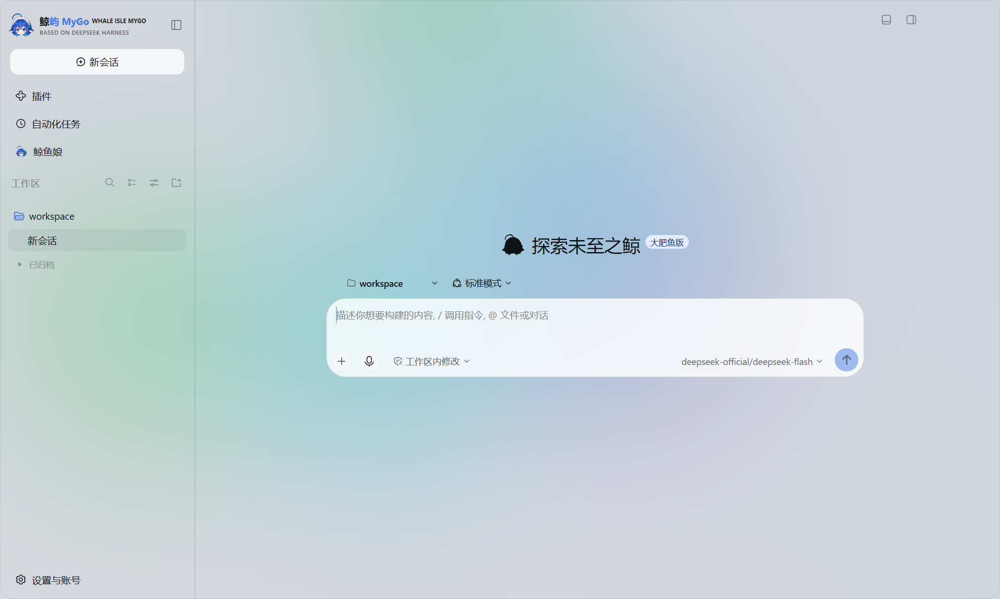

<p align="center">
  
</p>

<h1 align="center">Whale Isle MyGo · 鲸屿 MyGo</h1>

<p align="center">
  High-performance native desktop client built on DeepSeek Harness and Go / MyGo UI<br />
  Chat, workspace files, Ghostty terminal, Git, external ACP agents, and proactive background tasks in one native window.
</p>

<p align="center">
  <a href="README.md">中文</a> · English ·
  <a href="https://github.com/ChisaAlter/WhaleIsle-MyGo/releases/latest">Releases</a> ·
  <a href="https://github.com/ChisaAlter/WhaleIsle-MyGo/issues">Issues</a> ·
  <a href="https://github.com/ChisaAlter/WhaleIsle">Electron Desktop Repo</a>
</p>

<p align="center">
  <a href="https://github.com/ChisaAlter/WhaleIsle-MyGo/releases/latest"></a>
  <a href="LICENSE"></a>
  
  
  
</p>

<p align="center">
  
</p>

Community-maintained open-source project, not an official DeepSeek product.

## Overview

**Whale Isle MyGo** (`鲸屿 MyGo`) is the **native Go desktop edition** of [Whale Isle](https://github.com/ChisaAlter/WhaleIsle). Instead of running a full Chromium renderer for the main shell, it renders the workspace natively in Go via the bundled `MyGo` GPU UI engine and `libghostty-vt` terminal ABI while supervising the local [DeepSeek Harness](https://github.com/deepseek-ai/deepseek-harness) host.

### Side-by-Side Coexistence with the Electron App

| Aspect | Whale Isle MyGo (`WhaleIsle-MyGo`) | Whale Isle Electron (`WhaleIsle`) |
| --- | --- | --- |
| **UI & Terminal Stack** | Go + MyGo Native UI + `ghostty-vt` | Electron (Chromium) + Web UI |
| **Application ID** | `ai.deepseek.harness.gui.mygo` | `ai.deepseek.harness.gui` |
| **Windows Install Path** | `%LOCALAPPDATA%\Programs\WhaleIsle-MyGo` | `%LOCALAPPDATA%\Programs\Deepseek-Harness-Desktop` |
| **User Data & Sessions** | **Shared** `%APPDATA%\Deepseek-Harness-Desktop` (`~/Library/Application Support/Deepseek-Harness-Desktop` on macOS) | Same shared profile |
| **Concurrent Launch** | Supported side-by-side (automatically falls back to an isolated `native` lock and port `3180`) | Never overwritten |

## Download (v0.1.0)

| Platform | Version | Download | Notes |
| --- | --- | --- | --- |
| Windows 10+ · x64 | `v0.1.0` | [WhaleIsle-MyGo-Setup-0.1.0.exe](https://github.com/ChisaAlter/WhaleIsle-MyGo/releases/download/v0.1.0/WhaleIsle-MyGo-Setup-0.1.0.exe) | NSIS installer with `SHA256SUMS.txt` and delta `blockmap` |
| All Releases | Latest | [GitHub Releases](https://github.com/ChisaAlter/WhaleIsle-MyGo/releases/latest) | Includes native update catalog `WhaleIsle-MyGo-releases.json` |

## Highlights

- **Coding & Permission Gates**: Read/write files, search repositories, and execute commands with explicit per-action approval cards for privileged operations.
- **Native Workbench**: Built-in file browser, diff review, `ghostty-vt` terminal drawer, Git branch/commit controls, SSH remote workspaces, and isolated `whaleisle-preview` helper for interactive Whale UI & HTML previews.
- **External ACP Agents & MCP Bridge**: Connect external agent CLIs over T3 ACP with `t3-mcp-bridge` stdio tools and automatic `auto-allow` suppression during background task turns.
- **Desktop Companion & Proactive Tasks**: Companion pet window, background reading tasks, approved external delivery, and **Cordis tool provenance gating** against spoofed tool names.
- **Mobile Remote & Native Updater**: QR-code pairing for mobile web access and SHA-256 verified HTTP Range delta updates.

## Build from Source

```powershell
git clone https://github.com/ChisaAlter/WhaleIsle-MyGo.git
cd WhaleIsle-MyGo

. .\scripts\env.ps1
go build ./cmd/whaleisle ./cmd/whaleisle-launcher ./cmd/whaleisle-preview

# Stage and build the Windows NSIS installer
$env:WHALEISLE_VERSION = '0.1.0'
.\scripts\package.ps1
```

## License

Released under the [MIT License](LICENSE).
