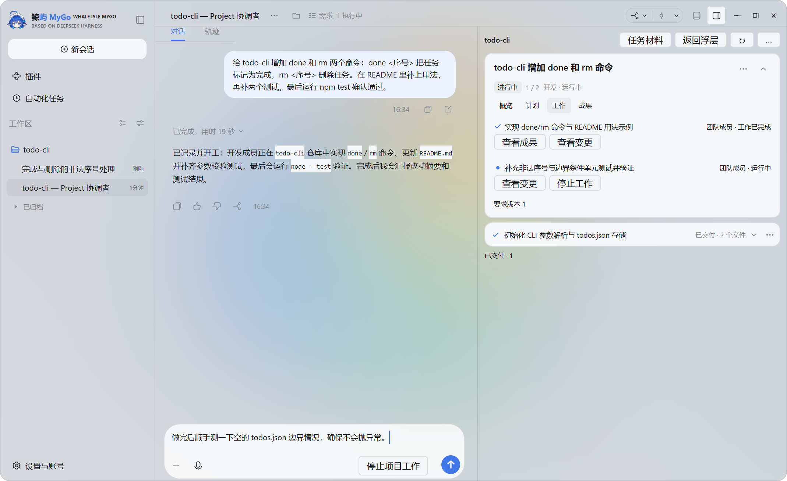
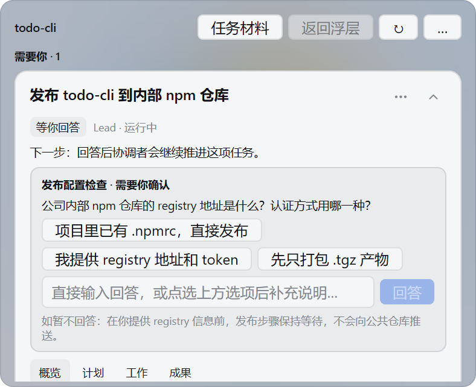
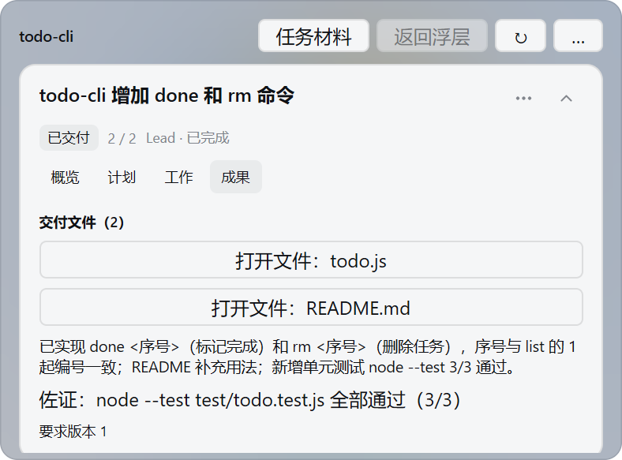
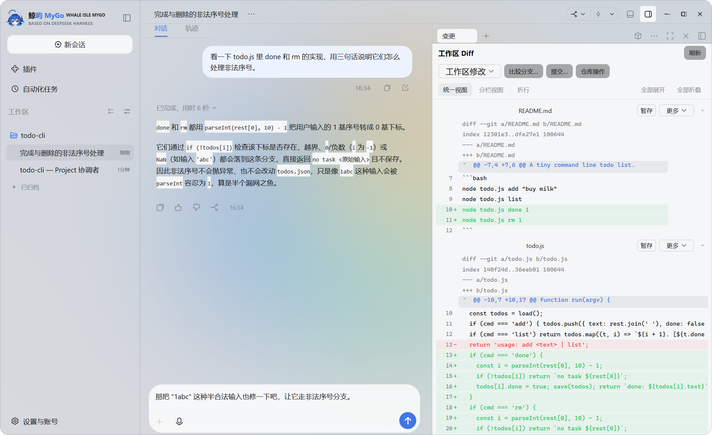
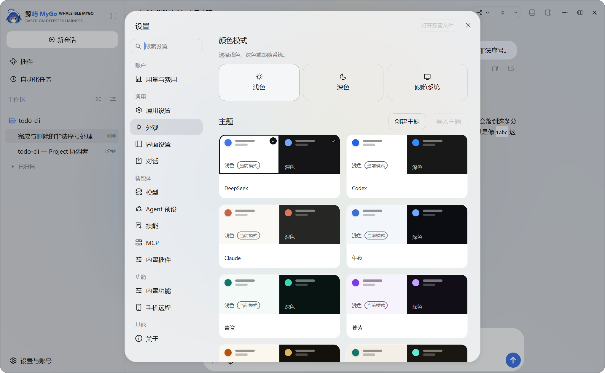
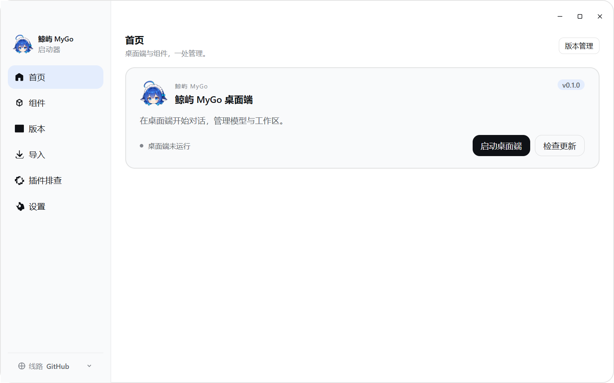

<p align="center">
  
</p>

<h1 align="center">Whale Isle MyGo</h1>

<p align="center">
  A native desktop client built on DeepSeek Harness<br />
  Rendered directly with Go and MyGo UI — conversations, files, terminal, Git and AI team work in one lightweight window.
</p>

<p align="center">
  <a href="README.md">中文</a> · English ·
  <a href="https://github.com/ChisaAlter/WhaleIsle-MyGo/releases/latest">Release notes</a> ·
  <a href="https://github.com/ChisaAlter/WhaleIsle-MyGo/issues">Report an issue</a> ·
  <a href="https://github.com/ChisaAlter/WhaleIsle">Whale Isle (Electron)</a>
</p>

<p align="center">
  <a href="https://github.com/ChisaAlter/WhaleIsle-MyGo/releases/latest"></a>
  <a href="LICENSE"></a>
  
  
  
</p>

<p align="center">
  
</p>

Independently maintained by the community, not an official DeepSeek product.

## What it is

Whale Isle MyGo turns [DeepSeek Harness](https://github.com/deepseek-ai/deepseek-harness) into a ready-to-use **native desktop app**. Its interface is drawn directly in Go with the built-in MyGo native UI engine — no Chromium renderer for the main window, faster cold starts and a lighter memory footprint, while the service and all your data stay on your machine.

| You want to | Whale Isle MyGo gives you |
| --- | --- |
| Change code together with a model | Read and write files, search repositories and run commands right in the conversation; privileged actions ask you first |
| Hand a task to an AI team | **Project**: state the goal, let the coordinator and members work in parallel, and step in only when a decision is needed |
| See results without leaving the window | Workspace files, Git diffs, a built-in terminal, branches, commits and web previews next to the chat |
| Run alongside the original Whale Isle | Installs into its own directory without overwriting [Whale Isle](https://github.com/ChisaAlter/WhaleIsle), while sharing your local sessions and model setup by default |

## Download

| Platform | Installer | Checksums & notes |
| --- | --- | --- |
| Windows 10+ · x64 · v0.1.1 | [WhaleIsle-MyGo-Setup-0.1.1.exe](https://github.com/ChisaAlter/WhaleIsle-MyGo/releases/download/v0.1.1/WhaleIsle-MyGo-Setup-0.1.1.exe) | [Release page & SHA256SUMS](https://github.com/ChisaAlter/WhaleIsle-MyGo/releases/tag/v0.1.1) |

The desktop installer is currently unsigned; if Windows SmartScreen prompts on first launch, choose **More info → Run anyway**. On macOS, you can build and run directly from source below.

## Getting started

1. Install and launch **Whale Isle MyGo** (the desktop app includes a built-in start page that manages updates, runtime setup, imports and components).
2. Open **Settings → Models** and configure an API provider; usage is billed by your chosen provider.
3. Pick a workspace folder or start a new conversation right away (if you already use Whale Isle, your existing sessions and model settings appear automatically).
4. To hand a directory to an AI team: enable **Project** in **Settings → Built-in features**, then open Project from the new-session screen.
5. To check in from your phone: scan the QR code in the **Remote** dialog.

## Highlights

### Project: state the goal, let a team do it

Project turns a local repository or folder into an ongoing workspace. Describe what you want in the main conversation; the coordinator breaks the work down across development, research and review members, while the right-hand observer tracks stages, member tasks and deliveries.

- **Interrupts you only when needed**: when a key detail or decision is missing, the coordinator pins one concrete question with clickable options so work resumes as soon as you answer.
- **Asks before taking extra permission**: commands outside the workspace sandbox pause above the input box for one-time approval.
- **Keeps sources and verification attached**: files changed and verification commands run are recorded alongside the delivery.
- **Deliveries you can inspect**: open delivered files, inspect workspace diffs, or archive completed requests at any time.

<table>
  <tr>
    <td align="center"></td>
    <td align="center"></td>
  </tr>
  <tr>
    <td align="center">Needs you: one concrete question, click an option or type</td>
    <td align="center">Delivered: summary, changed files and verification in one card</td>
  </tr>
</table>

### Development workbench

<p align="center">
  
</p>

- **Files and diff review**: browse and edit workspace files, and inspect staged or unstaged line-by-line diffs with stage, discard and branch comparison controls.
- **Native terminal and Git**: open the bottom terminal drawer anytime, switch branches, check repository status and commit from the title bar.
- **SSH remote workspaces**: open a directory on a remote machine and work with it just like a local folder.
- **External CLI agents**: connect external CLI coding agents alongside built-in Harness models.

Common shortcuts: `Ctrl+N` new session · `Ctrl+B` left sidebar · `Ctrl+\` right panel · `` Ctrl+` `` terminal · `Ctrl+,` settings.

### Appearance and more

<p align="center">
  
</p>

| Capability | What it does |
| --- | --- |
| **Whale UI interactive pages** | Charts, forms, diagrams, 3D scenes and web previews run in an on-demand helper process so idle sessions stay light |
| **Whale companion** | Optional desktop companion window and background reading tasks, with tool-source verification and approval before external actions |
| **Phone remote** | Connect from your phone via QR code; off by default and listens only when enabled |
| **Plugins, skills & MCP** | Manage skills, MCP servers and marketplace plugins, with optional WhaleBridge provider routing on Windows |
| **Resumable updates** | Downloads and verifies updates in the background with SHA-256 checks and automatic HTTP resume |
| **Themes & glass backdrop** | Light, dark or system mode, built-in color themes, font tuning, aurora gradients and custom wallpapers |

<p align="center">
  
</p>

## FAQ

- **Does it cost money?** The app is free and open source (MIT); your configured model provider charges for API usage.
- **Will it conflict with the original Whale Isle?** No. Whale Isle MyGo installs to `%LOCALAPPDATA%\Programs\WhaleIsle-MyGo` with its own app ID, shortcuts and update channel. Both editions can stay installed and even run at the same time.
- **Where is my data stored?** By default it shares `%APPDATA%\Deepseek-Harness-Desktop` on Windows (`~/Library/Application Support/Deepseek-Harness-Desktop` on macOS) so your sessions and settings carry over seamlessly. To import skills, MCP servers or settings from the official `~/.dsh` CLI, use the **Import** tab on the start page.
- **How do I upgrade?** Click **Check for updates** on the start page or in **Settings → About** to download, verify and install new releases. Downloads can be paused and resumed.

## Run from source

Requires Git, Go `1.25+`, and Node.js `22.19+` or `24+` (used to run the local DeepSeek Harness service).

```powershell
git clone https://github.com/ChisaAlter/WhaleIsle-MyGo.git
cd WhaleIsle-MyGo

# Configure the Go toolchain environment and build the desktop app and preview helper
. .\scripts\env.ps1
go build ./cmd/whaleisle ./cmd/whaleisle-preview

# Optional: package the Windows NSIS installer
$env:WHALEISLE_VERSION = '0.1.1'
.\scripts\package.ps1
```

| Directory | Contents |
| --- | --- |
| `cmd/whaleisle` | Whale Isle MyGo desktop shell and window lifecycle |
| `cmd/whaleisle-preview` | On-demand helper process for web and interactive card previews |
| `internal/ui` | Native UI surfaces built on MyGo UI (chat, workbench, Project, settings, launcher) |
| `internal/desktop` | Desktop integrations (Git, SSH remote, phone remote, companion, updater) |
| `internal/harness` | Local DeepSeek Harness supervisor and runtime preparation |
| `third_party/mygo` | Bundled cross-platform native windowing and UI engine |
| `scripts/` | Build, runtime staging and installer packaging scripts |

## Feedback and acknowledgements

Found a bug or have an idea? Open an [issue](https://github.com/ChisaAlter/WhaleIsle-MyGo/issues).

Thanks to [DeepSeek Harness](https://github.com/deepseek-ai/deepseek-harness), [Whale Isle](https://github.com/ChisaAlter/WhaleIsle), [yetone / Magpie](https://github.com/yetone/magpie) and the [Linux.do](https://linux.do) community. · [MIT](LICENSE)
