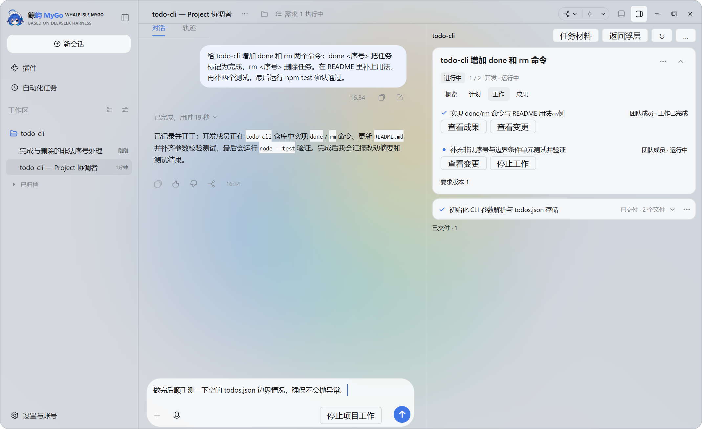
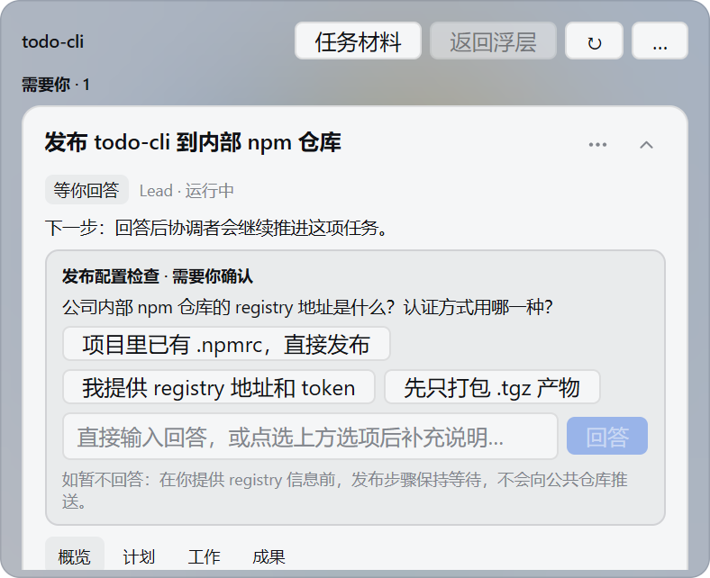
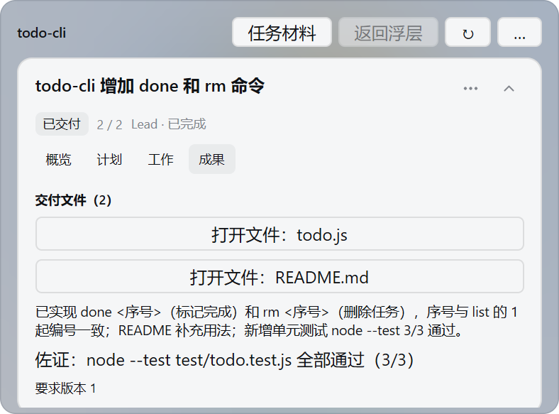
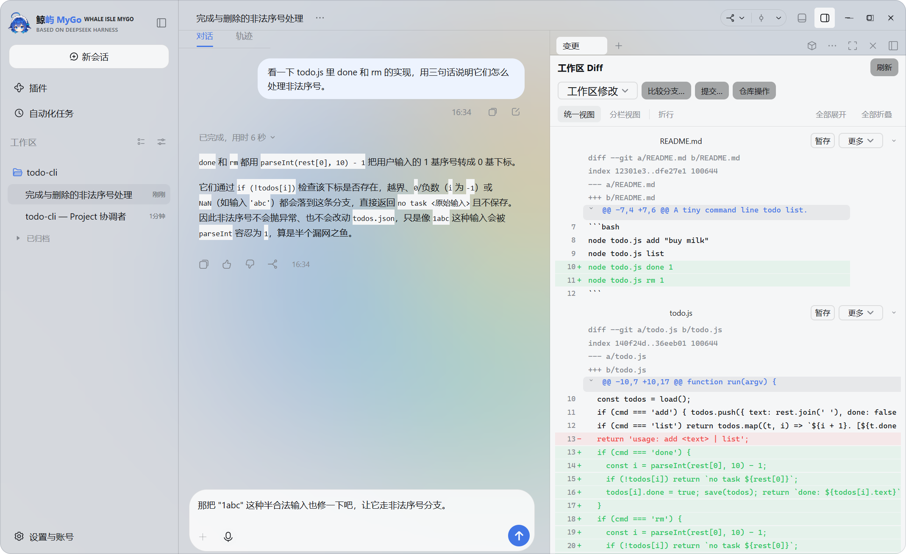
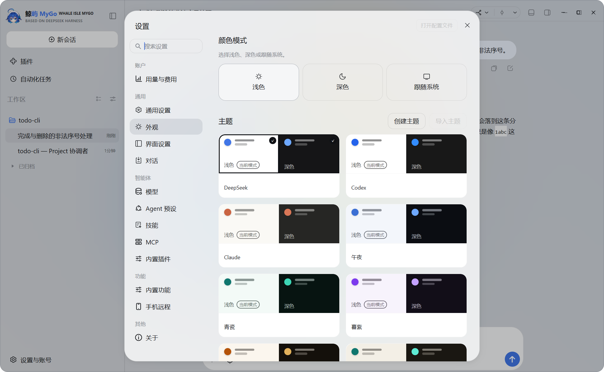

<p align="center">
  
</p>

<h1 align="center">鲸屿 MyGo</h1>

<p align="center">
  基于 DeepSeek Harness 的原生桌面客户端<br />
  用 Go 与 MyGo UI 直接绘制界面——对话、文件、终端、Git 与 AI 团队协作，一个轻量窗口完成。
</p>

<p align="center">
  中文 · <a href="README.en.md">English</a> ·
  <a href="https://github.com/ChisaAlter/WhaleIsle-MyGo/releases/latest">更新说明</a> ·
  <a href="https://github.com/ChisaAlter/WhaleIsle-MyGo/issues">反馈</a> ·
  <a href="https://github.com/ChisaAlter/WhaleIsle">原版鲸屿</a>
</p>

<p align="center">
  <a href="https://github.com/ChisaAlter/WhaleIsle-MyGo/releases/latest"></a>
  <a href="LICENSE"></a>
  
  
  
</p>

<p align="center">
  
</p>

社区独立维护，非 DeepSeek 官方产品。

## 它是什么

鲸屿 MyGo 把 [DeepSeek Harness](https://github.com/deepseek-ai/deepseek-harness) 做成开箱即用的**原生桌面应用**：界面由 Go 与内置的 MyGo 原生图形引擎直接绘制，省去了主窗口的浏览器渲染进程，启动更快、常驻内存更省；服务在本机运行，数据保存在本机。

MyGo 没有启动器。打开应用即进入原生工作台；是否自动启动 Host 可在「设置 → 通用」调整。组件、数据导入、启动诊断和更新也从设置按需打开。

| 你想做的事 | 鲸屿 MyGo 提供 |
| --- | --- |
| 和模型一起改代码 | 对话里直接读写文件、搜索仓库、运行命令；需要更高权限的操作先请你批准 |
| 把一件事交给 AI 团队 | **Project**：说目标，协调者与成员分头推进，只在需要你拍板时才打扰你 |
| 不离开窗口看结果 | 工作区文件、Git Diff、内嵌终端、分支与提交、网页预览都在对话旁边 |
| 和已有鲸屿并存使用 | 安装在独立目录，不覆盖原版 [鲸屿 Whale Isle](https://github.com/ChisaAlter/WhaleIsle)；首次运行可选把原版会话与模型配置复制到 MyGo 自己的数据目录 |

## 下载

| 平台 | 安装包 | 校验与说明 |
| --- | --- | --- |
| Windows 10+ · x64 · v0.1.1 | [WhaleIsle-MyGo-Setup-0.1.1.exe](https://github.com/ChisaAlter/WhaleIsle-MyGo/releases/download/v0.1.1/WhaleIsle-MyGo-Setup-0.1.1.exe) | 约 301 MiB，已内置运行时，安装后无需再下载。[发布页与 SHA256 清单](https://github.com/ChisaAlter/WhaleIsle-MyGo/releases/tag/v0.1.1) |

桌面安装包暂未附带商业代码签名，Windows 首次运行若弹出 SmartScreen 提示，点击「更多信息 → 仍要运行」即可。Mac 版本可通过下方源码方式直接编译运行。

## 快速开始

1. 安装并打开 **鲸屿 MyGo**。自动启动 Host 时，主窗口先显示原生加载页，就绪后进入工作台；关闭自动启动时直接进入工作台。
2. 打开「设置 → 模型」配置 API 服务，模型调用费用由你所选的服务商收取。
3. 选择一个本地工作目录，或直接新建会话开始对话（若已安装原版鲸屿，原有的模型配置与历史会话会自动出现）。
4. 想把目录交给团队长期推进：在「设置 → 内置功能」开启 **Project**，再在新会话首屏进入 Project。
5. 想在手机上接着看：在桌面端打开「远程」扫码连接。

## 亮点

### Project：说目标，团队来做

Project 把一个本地代码库或目录变成可持续推进的项目。你在主对话里描述目标，协调者拆解任务并交给开发、调研、评审等成员分头完成；右侧观察面板实时展示当前进度、成员工作与交付成果。

- **只在需要你时打扰你**：缺少关键信息或需要你做决定时，协调者会置顶提出一个具体问题并附带可点选的答案，回答后自动继续。
- **要权限先问**：成员需要执行超出当前权限范围的命令时，输入框上方会弹出单次审批卡片，点「允许一次」才执行一次。
- **能查阅资料与留痕**：成员查阅的文档与验证命令会记录在交付卡片里，方便随时核对依据。
- **结果看得见**：交付后可直接打开改动文件、对比工作区差异，或归档已完成的要求。

<table>
  <tr>
    <td align="center"></td>
    <td align="center"></td>
  </tr>
  <tr>
    <td align="center">需要你：一个具体问题，点选或输入即可继续</td>
    <td align="center">已交付：改动摘要、交付文件与测试验证一目了然</td>
  </tr>
</table>

### 开发工作台

<p align="center">
  
</p>

- **文件与变更审阅**：浏览、编辑工作区文件，右侧「差异」面板直接查看未暂存 / 已暂存的行级红绿对比，支持暂存、还原与分支比较。
- **原生终端与 Git**：底部原生终端抽屉即开即用，标题栏直接切换分支、查看仓库状态与提交改动。
- **SSH 远程工作区**：连接远程开发机上的目录，像操作本地文件夹一样浏览与对话。
- **外部智能体协作**：除内置模型外，也可接入外部命令行智能体协同完成编码任务。

常用快捷键：`Ctrl+N` 新会话 · `Ctrl+B` 侧边栏 · `Ctrl+\` 右侧栏 · `` Ctrl+` `` 终端 · `Ctrl+,` 设置。

### 外观与更多能力

<p align="center">
  
</p>

| 能力 | 说明 |
| --- | --- |
| **Whale UI 交互页面** | 对话里生成的图表、表单、流程图、3D 与网页内容，由按需启动的独立预览进程承载，平时不占内存 |
| **鲸鱼娘伴侣** | 支持桌面伴侣小窗与后台资料整理任务；涉及外发消息或敏感工具时会先核验来源并请你确认 |
| **手机远程** | 扫码在手机端查看会话与进展；默认关闭，开启后才开始监听 |
| **插件、技能与 MCP** | 内置技能管理、MCP 服务配置与插件市场，亦可配合鲸桥统一管理多家模型供应商与路由 |
| **后台断点续传更新** | 更新中心在后台分块下载并校验安装包，网络中断或重启应用后可接着下载 |
| **多主题与毛玻璃** | 浅色 / 深色 / 跟随系统，内置多套配色皮肤、字体微调、极光渐变与自定义壁纸 |

<p align="center">
  
</p>

## 常见问题

- **要花钱吗？** 软件免费开源（MIT）；模型调用费用由你自己在「设置 → 模型」中配置的服务商收取。
- **已安装原版鲸屿，再装 MyGo 版会冲突吗？** 不会。鲸屿 MyGo 默认安装在 `%LOCALAPPDATA%\Programs\WhaleIsle-MyGo`，拥有独立的应用标识、快捷方式和更新通道，不会覆盖原版，两个版本甚至可以同时打开运行。
- **数据保存在哪？** 默认在 MyGo 自己的 `%APPDATA%\WhaleIsle-MyGo\data`（macOS 为 `~/Library/Application Support/WhaleIsle-MyGo/data`），不再与原版鲸屿写入同一份数据。第一次在没有数据的目录启动时，若检测到原版 `%APPDATA%\Deepseek-Harness-Desktop` 的数据，会询问是否复制过来：只复制、不移动、不删除原数据，跳过之后也可以从「设置 → 通用 → 数据位置 → 从原版鲸屿导入…」再做一次。选定的位置记录在 `%APPDATA%\WhaleIsle-MyGo\data-location.json`，记录本身不放在数据目录里；也可以在「设置 → 通用 → 数据位置」用原生目录选择器改到其他磁盘，重启后生效，原目录不会被删除。`WHALEISLE_USER_DATA` 环境变量优先级最高，可把数据临时指向别处（测试与隔离运行使用）。若需导入官方 CLI `~/.dsh` 的配置，可从「设置 → 通用 → 导入数据」选择要导入的内容。
- **怎么升级？** 在托盘菜单或「设置 → 关于」中点击「检查更新」，下载校验完成后即可一键安装更新；支持暂停、断点续传。

## 从源码运行

需要 Git、Go `1.25+` 以及 Node.js `22.19+` 或 `24+`（用于运行本地 DeepSeek Harness 服务）。Windows 下仓库提供了自动配置脚本：

```powershell
git clone https://github.com/ChisaAlter/WhaleIsle-MyGo.git
cd WhaleIsle-MyGo

# 加载本地 Go 工具链环境并编译桌面端与预览进程
. .\scripts\env.ps1
go build ./cmd/whaleisle ./cmd/whaleisle-preview

# 验收临时文件在命令结束后回收，编译/下载缓存仍跨项目共享
.\scripts\with-build-workspace.ps1 { go test ./internal/store/... }

# 如需打包 Windows 安装程序
$env:WHALEISLE_VERSION = '0.1.1'
.\scripts\package.ps1 -CleanStage
```

Go 默认使用用户级共享缓存，显式设置的 `GOCACHE`、`GOMODCACHE` 等仍有效。`-CleanStage` 只在安装包和更新元数据生成成功后回收本轮打包副本；需要保留副本时省略它，`-StageOnly` 也继续保留输出。临时验收用法见 [构建产物管理](docs/build-storage.md)。

| 目录 | 内容 |
| --- | --- |
| `cmd/whaleisle` | 鲸屿 MyGo 桌面主程序入口与窗口管理 |
| `cmd/whaleisle-preview` | 按需启动的网页与交互式卡片预览辅助进程 |
| `internal/ui` | 基于 MyGo UI 实现的全部原生界面（对话、工作台、Project、设置与按需维护） |
| `internal/desktop` | 桌面能力集成（Git、SSH 远程、手机远程、桌宠、更新中心等） |
| `internal/harness` | 本地 DeepSeek Harness 服务监管与运行时准备 |
| `third_party/mygo` | 内置的跨平台原生桌面与图形界面引擎 |
| `scripts/` | 构建、运行时装配与安装包打包脚本 |

## 开发技术路线

后续开发遵循 [核心架构与技术路线](ARCHITECTURE.md)：**原生核心工作台 + DSH 前端插件兼容容器**。核心编码体验优先，同时承接 DSH 插件、左侧自定义扩展空间、会话 View 与右侧工具；不要求插件作者另写 Go 界面。文档区分目标设计、现有实现和验收条件。

## 反馈与致谢

遇到问题或有功能建议，欢迎提交 [Issue](https://github.com/ChisaAlter/WhaleIsle-MyGo/issues)。

感谢 [DeepSeek Harness](https://github.com/deepseek-ai/deepseek-harness)、[鲸屿 Whale Isle](https://github.com/ChisaAlter/WhaleIsle)、[yetone / Magpie](https://github.com/yetone/magpie) 与 [Linux.do](https://linux.do) 社区。· [MIT](LICENSE)
