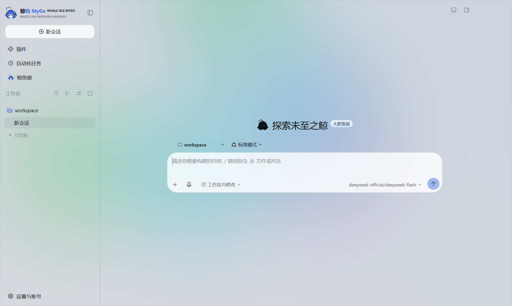

<p align="center">
  
</p>

<h1 align="center">鲸屿 MyGo · Whale Isle MyGo</h1>

<p align="center">
  基于 DeepSeek Harness 与原生 Go / MyGo UI 引擎构建的高性能桌面客户端<br />
  对话、工作区文件、Ghostty 终端、Git、外部 ACP Agent 与鲸鱼娘主动任务，一个原生窗口完成。
</p>

<p align="center">
  中文 · <a href="README.en.md">English</a> ·
  <a href="https://github.com/ChisaAlter/WhaleIsle-MyGo/releases/latest">更新说明</a> ·
  <a href="https://github.com/ChisaAlter/WhaleIsle-MyGo/issues">问题反馈</a> ·
  <a href="https://github.com/ChisaAlter/WhaleIsle">Electron 本体仓库</a>
</p>

<p align="center">
  <a href="https://github.com/ChisaAlter/WhaleIsle-MyGo/releases/latest"></a>
  <a href="LICENSE"></a>
  
  
  
</p>

<p align="center">
  
</p>

社区独立维护，非 DeepSeek 官方产品。

## 它是什么

**鲸屿 MyGo**（`Whale Isle MyGo`）是 [鲸屿 Whale Isle](https://github.com/ChisaAlter/WhaleIsle) 的**原生 Go 桌面重构版**。它摒弃主界面的重型 Chromium 渲染进程，改用 Go 与内置的 `MyGo` 原生 GPU UI 框架绘制桌面界面，结合 `libghostty-vt` 原生终端解析与本机 [DeepSeek Harness](https://github.com/deepseek-ai/deepseek-harness) 服务，带来更低的内存占用、更快的冷启动响应与一致的功能体验。

### 与 Electron 本体的关系（独立共存 · 数据共享）

| 维度 | 鲸屿 MyGo (`WhaleIsle-MyGo`) | 鲸屿 Electron 本体 (`WhaleIsle`) |
| --- | --- | --- |
| **界面与终端引擎** | Go + MyGo 原生 UI + `ghostty-vt` 原生终端 | Electron (Chromium) + Web 前端 |
| **应用身份 (`AppID`)** | `ai.deepseek.harness.gui.mygo` | `ai.deepseek.harness.gui` |
| **Windows 默认安装目录** | `%LOCALAPPDATA%\Programs\WhaleIsle-MyGo` | `%LOCALAPPDATA%\Programs\Deepseek-Harness-Desktop` |
| **用户数据与会话目录** | **共享** `%APPDATA%\Deepseek-Harness-Desktop`（macOS 为 `~/Library/Application Support/Deepseek-Harness-Desktop`） | 同左 |
| **双端同时运行** | 支持并存安装与同时启动（自动回退 `native` 子目录锁并监听独立端口 `3180`） | 互不覆盖、互不干扰 |

## 下载（v0.1.0）

| 平台 | 版本 | 下载链接 | 说明 |
| --- | --- | --- | --- |
| Windows 10+ · x64 | `v0.1.0` | [WhaleIsle-MyGo-Setup-0.1.0.exe](https://github.com/ChisaAlter/WhaleIsle-MyGo/releases/download/v0.1.0/WhaleIsle-MyGo-Setup-0.1.0.exe) | NSIS 安装包（附 `SHA256SUMS.txt` 与增量 `blockmap`） |
| 全部发行版 | 最新版 | [GitHub Releases](https://github.com/ChisaAlter/WhaleIsle-MyGo/releases/latest) | 含更新目录 `WhaleIsle-MyGo-releases.json` |

> 桌面壳安装包可复用本机已配置的 Node.js 与 DeepSeek Harness 运行时（已对齐 Harness `0.2.1-rc.4` 与本体 `0.3.14` 协议）。

## 核心能力

- **AI 对话与权限审批**：在本地工作区直接读写文件、搜索代码、执行命令；超出工作区或高风险操作在输入框上方弹出单次审批卡片。
- **原生开发工作台**：
  - **工作区文件与 Diff 审阅**：内置文件树、代码高亮与变更对比视图，支持按工作区或平铺分组管理会话。
  - **原生终端与 Git**：集成 `ghostty-vt` 终端抽屉，顶栏直接查看分支状态与提交变更，支持 SSH 远程工作区。
  - **交互式预览与 Whale UI**：支持 HTML / Office 文档预览，以及包含图表、Mermaid、3D 与表单的交互式回复卡片（通过独立隔离的 `whaleisle-preview` 辅助进程按需承载）。
- **外部 ACP Agent 与 MCP 桥**：支持接入外部 Agent CLI（T3 ACP 协议），内置 `t3-mcp-bridge` stdio 工具桥，并在后台任务回合自动收紧 `auto-allow` 权限策略。
- **鲸鱼娘伴侣与后台主动任务**：
  - 独立桌面宠物窗口（支持 Live2D / THA4 渲染资产）与专属伴侣会话。
  - 支持后台资料阅读整理、主动关怀投递（会话内或飞书等渠道审批外发），内置 **Cordis 工具来源识别门禁**，拦截未登记或同名伪造工具调用。
- **手机远程与原生更新中心**：
  - 支持局域网或中继扫码连接移动端页面，默认关闭，按需开启监听。
  - 内置面向独立仓库的原生更新中心，支持 SHA-256 校验与 HTTP Range 分块增量续传。

常用快捷键：`Ctrl+N` 新会话 · `Ctrl+B` 收起侧栏 · `Ctrl+\` 右侧面板 · `` Ctrl+` `` 终端 · `Ctrl+,` 设置。

## 从源码构建与运行

### 环境要求
- Go `1.25+`（Windows 下可通过 `./scripts/env.ps1` 自动配置本地 `.toolchain` 环境）
- Node.js `22.19+` 或 `24+`（用于运行本地 DeepSeek Harness Host）
- Windows 打包可选：NSIS `3.x`（可由 `./scripts/smoke-nsis.ps1 -EnsureNsis` 自动拉取至 `.toolchain/nsis`）

### 编译与启动

```powershell
git clone https://github.com/ChisaAlter/WhaleIsle-MyGo.git
cd WhaleIsle-MyGo

# 加载工具链环境变量并编译主程序、启动器与预览辅助进程
. .\scripts\env.ps1
go build ./cmd/whaleisle ./cmd/whaleisle-launcher ./cmd/whaleisle-preview

# 构建 Windows 安装包（指定版本号）
$env:WHALEISLE_VERSION = '0.1.0'
.\scripts\package.ps1
```

### 仓库结构

| 目录 | 说明 |
| --- | --- |
| `cmd/whaleisle` | `鲸屿 MyGo` 原生桌面主程序入口与窗口生命周期 |
| `cmd/whaleisle-launcher` | 独立启动器（运行时管理、数据导入与更新入口） |
| `cmd/whaleisle-preview` | 隔离的网页 / Whale UI 预览辅助进程 |
| `internal/ui` | 基于 MyGo UI 构建的全部原生界面组件（侧栏、对话、编辑器、设置、工作台等） |
| `internal/desktop` | 桌面系统集成（ACP、主动任务安全门禁、桌宠、手机远程、通知、原生更新等） |
| `internal/harness` | DeepSeek Harness Host 进程监管、预加载补丁与运行时准备 |
| `internal/dsh` | 类型化 RPC 客户端与协议生成代码 |
| `third_party/mygo` | 内置的 MyGo 跨平台原生桌面与 UI 引擎 |
| `scripts/` | 跨平台构建、运行时装配、NSIS 打包与冒烟测试脚本 |

## 致谢与许可

感谢 [DeepSeek Harness](https://github.com/deepseek-ai/deepseek-harness)、[鲸屿 Whale Isle](https://github.com/ChisaAlter/WhaleIsle) 及开源社区贡献者。

本项目基于 [MIT License](LICENSE) 开源。
