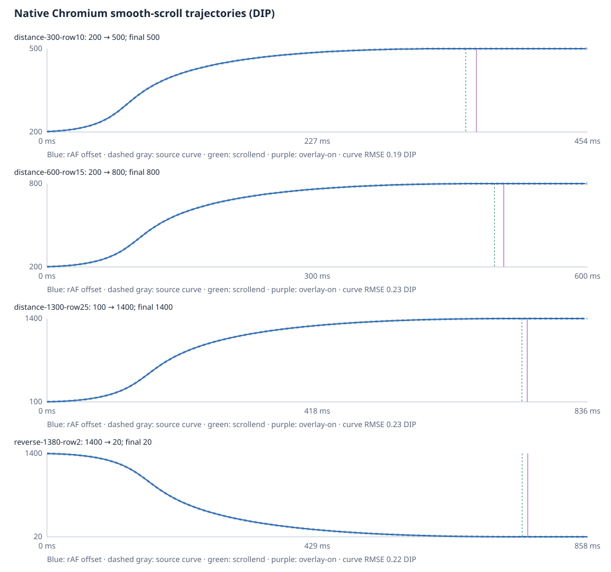
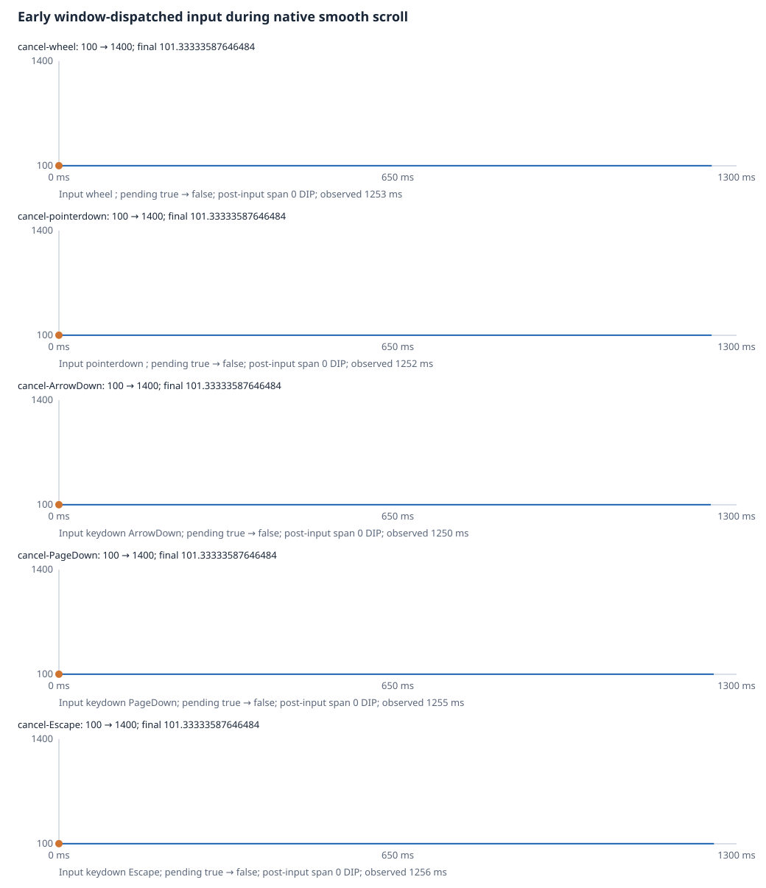

# Installed InspectorChatRevealer smooth-scroll evidence

Captured 2026-10-23T19:13:39.986Z. Result: **PASS**. Chromium Chrome/152.0.7977.78; Electron 44.3.0.

The installed factory was read from disk, exported only from an in-memory copy, and run in the exact owned reference page. Chat geometry: 40 rows × 60 DIP; scroll viewport 260 DIP high at Y=40; 60 DIP composer at Y=300. The original bundle hash was unchanged. All reveal triggers and interruption events were synthetic window dispatches; no browser-default wheel/key scrolling or Host/model action contributed to the offsets.

## Trajectories

| Case | Offset | First movement → last movement (ms) | First movement → scrollend (ms) | Scrollend → overlay (ms) | Source nominal (ms) | Source curve RMSE / max (DIP) |
|---|---:|---:|---:|---:|---:|---:|
| distance-300-row10 | 200 → 500 | 318.60 | 349.20 | 9.00 | 353.55 | 0.19 / 0.38 |
| distance-600-row15 | 200 → 800 | 465.40 | 490.60 | 10.40 | 500.00 | 0.23 / 0.59 |
| distance-1300-row25 | 100 → 1400 | 703.20 | 732.80 | 8.20 | 735.98 | 0.23 / 0.97 |
| reverse-1380-row2 | 1400 → 20 | 729.20 | 752.50 | 8.80 | 758.29 | 0.22 / 0.84 |

Captured Page.getLayoutMetrics reports native layout viewport 540 × 540, versus CSS viewport 360 × 360: physical/CSS scale 1.5. Electron was launched with native --device-scale-factor=1.5. CDP DPR emulation changes the web-exposed DPR to about 1 but leaves this native viewport ratio at 1.5. The source delta must use that captured physical scale.

Every rAF includes its high-resolution browser timestamp, performance.now(), document.timeline.currentTime, scrollTop, pending state and overlay presence. The comparison starts at first nonzero movement and fixes duration from physical delta. Because the first web offset is quantized, only its time origin is aligned within two observed frame gaps (at most 40 ms); duration is never fitted. The JSON retains both the raw first-sample anchor score and CSS-only prediction error, as well as the bounded origin alignment. Durations/offsets are descriptive measurements, not frame-exact assertions. Scheduler gaps and physical-pixel quantization remain in the raw trace.



## Interruption and controls

| Input after first movement | Offset before → after → final | Pending before → after | Post-input offset span (DIP) | Observation after input (ms) | Overlay ever after input |
|---|---:|---|---:|---:|---|
| wheel | 101.33333587646484 → 101.33333587646484 → 101.33333587646484 | true → false | 0.00 | 1252.50 | false |
| pointerdown | 101.33333587646484 → 101.33333587646484 → 101.33333587646484 | true → false | 0.00 | 1252.30 | false |
| keydown "ArrowDown" | 101.33333587646484 → 101.33333587646484 → 101.33333587646484 | true → false | 0.00 | 1250.30 | false |
| keydown "PageDown" | 101.33333587646484 → 101.33333587646484 → 101.33333587646484 | true → false | 0.00 | 1255.20 | false |
| keydown "Escape" | 101.33333587646484 → 101.33333587646484 → 101.33333587646484 | true → false | 0.00 | 1255.60 | false |
| keydown "a" | 101.33333587646484 → 101.33333587646484 → 1400 | true → true | 1297.33 | 1571.20 | true |
| click | 101.33333587646484 → 101.33333587646484 → 1400 | true → true | 1297.33 | 1554.20 | true |

Cancellation events fired on the first nonzero movement rAF, while the installed revealer still had a pending scroll and before the overlay existed. The delegated native instant scrollTo call froze the offset at its current value. Cancellation cases remained sampled for at least 1250 ms; ordinary “a” and a second window click retained the pending reveal, completed the trajectory, flashed, and removed the overlay.

The idle click control had no reveal listener, no scrollIntoView call, no movement, and no overlay. Every reveal-trigger click also left the offset unchanged immediately after window.dispatchEvent returned; movement began on subsequent native frames.



## Source pointers

Installed bundle: `C:\软件\Whale Isle\resources\vendor\deepseek-harness\packages\experimental\session-inspector\lib\client.js` (SHA-256 `62443553c0dec20f1d1a21b02a55822877c734059ea1c18d5a414ddafac657a0`). Lines 3684–3769 own native scrolling, scrollend/quiet completion and interruption; 3765–3769 call smooth/center/nearest; 3771–3793 own the 700 ms overlay.

- [third_party/blink/renderer/core/scroll/programmatic_scroll_animator.cc](https://raw.githubusercontent.com/chromium/chromium/152.0.7977.78/third_party/blink/renderer/core/scroll/programmatic_scroll_animator.cc): ProgrammaticScrollAnimator::AnimateToOffset creates kProgrammatic; main-thread TickAnimation evaluates monotonic_time - start_time_.
- [cc/animation/scroll_offset_animation_curve_factory.cc](https://raw.githubusercontent.com/chromium/chromium/152.0.7977.78/cc/animation/scroll_offset_animation_curve_factory.cc): GetDurationBehaviorFromScrollType(kProgrammatic) returns kDeltaBased.
- [cc/animation/scroll_offset_animation_curve.cc](https://raw.githubusercontent.com/chromium/chromium/152.0.7977.78/cc/animation/scroll_offset_animation_curve.cc): EaseInOutSegmentDuration: min(sqrt(abs(maximum delta)), maxDurationSeconds*60)/60 seconds; GetValue uses timing_function_->GetValue(t/duration).
- [cc/base/features.cc](https://raw.githubusercontent.com/chromium/chromium/152.0.7977.78/cc/base/features.cc): Desktop defaults PROGRAMMATIC_SCROLL_ANIMATION_CURVE(0.4,0.0,0.0,1.0,1500); Android defaults differ.

This browser version’s desktop defaults are cubic-bezier(0.4, 0, 0, 1) and min(sqrt(abs(physical delta))/60, 1.5) seconds. At the captured native 1.5 scale, 300/600/1300/1380 DIP predict 353.55/500.00/735.98/758.29 ms. The legacy ease-in-out curve is also scored in the JSON as a comparison; no feature/curve override was installed.

## Ownership and reproduction

Only debugger 19444 target AF1357A4634ECA17E3CB0508BE1D2A55 at http://127.0.0.1:3083/ was used. Owned main PID 16764; backend PID 8040. Exact profile: `C:\AI\WhaleIsle-MyGo\.devdata-ref-r100`. Protected main PID 20012/backend PID 16008 on 3080 were only read for identity checks.

Launch command (after verifying ports 3083 and 19444 are free; capture the newly returned main PID):

```powershell
Remove-Item Env:ELECTRON_RUN_AS_NODE -ErrorAction SilentlyContinue
$owned = Start-Process -FilePath 'C:\软件\Whale Isle\Whale Isle.exe' -ArgumentList '--user-data-dir="C:\AI\WhaleIsle-MyGo\.devdata-ref-r100"','--remote-debugging-port=19444' -PassThru
```

Exact probe command for this run:

```powershell
& 'C:\Users\48818\AppData\Roaming\Deepseek-Harness-Desktop\dsh-home\dsh-runtimes\dsh-primary-runtime\dependencies\node\bin\node.exe' 'scripts/inspector-reference-smooth-scroll.mjs' '19444' 'http://127.0.0.1:3083/' 'C:\软件\Whale Isle\resources\vendor\deepseek-harness\packages\experimental\session-inspector\lib\client.js' 'docs/review-20261022/evidence/inspector-reference-pass251-smooth' '16764'
```

The probe does not launch or terminate the app. The outer bounded run closed main PID 16764 and its seven descendants, released 3083/19444, and verified original main PID 20012/backend PID 16008 still owning 3080. The exact checked tree, teardown command, and final listeners are in the [lifecycle evidence](./inspector-reference-pass251-smooth-lifecycle.json).

Checks: 106; errors: 0.
