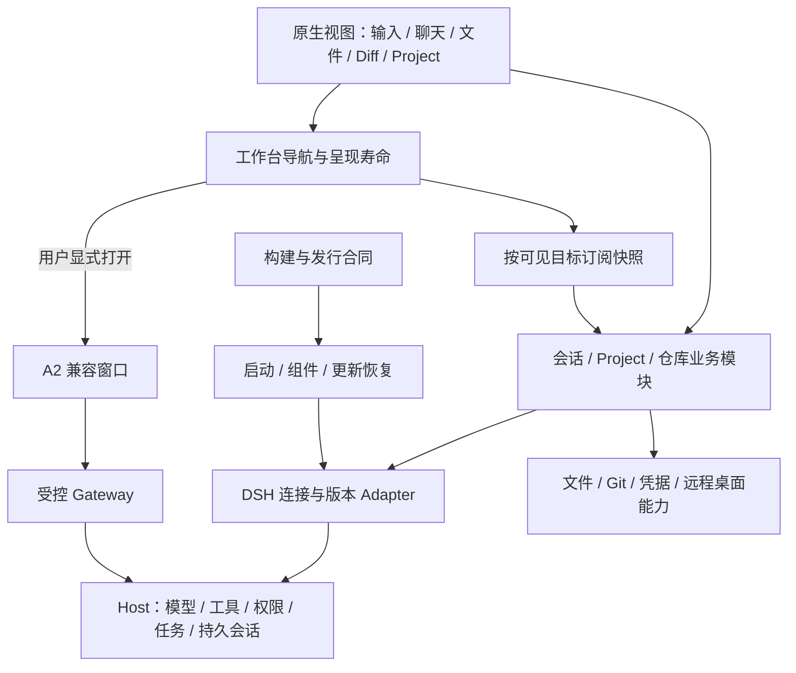

# 路线 A 系统优化方案：原生工作台、明确归属、按需资源

日期：2026-11-17。设计对象：`main` / `11595831f43af4e401bdb613a2e744d6bfe2a5af`。

**推荐方向：在现有 Go/MyGo + DSH Host 架构上，完成工作流归属和资源生命周期的系统收敛。日常工作台保持纯原生；业务执行由 Host 负责；界面只观察所需状态；Web 和重型可选能力显式开启、及时释放。**

本文是基于[当前审查报告](review-20261117/REVIEW.md)的系统优化方案，已获用户批准执行。当前在 `codex/route-a-system-optimization` 实施；实现与接受状态见下节。已确定的产品方向继续以 [ARCHITECTURE.md](../ARCHITECTURE.md) 为依据。此前[优化计划](optimization-plan.md)中的实现和实测保留为历史证据，不作为本候选的全面通过结论。

## 当前实施记录

**2026-11-18：取消性能硬要求。** 用户决定不再把性能预算当作交付门禁：§10 的预算表改为参考观测值，工作区 3 秒和空闲 CPU 0.5% 两项不再列为未关闭项。数据照常记录、照常同条件对照，供以后比较；不达标不阻塞交付。

**本轮证据的提交口径。** `route-a-implementation-20261117/` 下的 `*.json`、`*.png`、`*.md`、`*.txt` 随源码提交；下文链接的 `*.log` 只作本机证据保留，被全局 `*.log` 忽略规则排除，不进仓库，克隆后指向这些日志的链接不解析。`*.cpuprofile`、`*.pprof`、`*.mem`、`*.cpu` 及由它们导出的 `.reads.json` 同为可再生成的测量中间物，同样不提交。

**2026-11-18：MyGo 移除启动器，保留原生加载页。** 自动启动时先显示海面加载页，工作区就绪后在同一窗口进入工作台；手动启动模式直接进入工作台。组件、导入、诊断和更新仍从设置及对应状态按需打开，首次账户引导和托盘合同不变。独立启动器目标和内置启动器路由均退役。旧深链和快捷键标识导向桌面设置。鲸屿本体不改。下列无启动器安装包记录为此次加载页及历史兼容修复前的证据。

- [当前 Windows 生产候选](../bin/route-a-no-launcher-0.2.0-candidate.exe)为 96,276,992 字节（91.817 MiB），源码相关包的测试通过。[可见自动启动](route-a-implementation-20261117/no-launcher-visible.json)用合成 profile 和真实 rc.4 Host，原生界面构建 256 ms、Host 6.206 秒、工作区 6.453 秒，分别记录，不把界面构建时间当作输入或实际呈现延迟。[可见手动启动配置](route-a-implementation-20261117/no-launcher-manual-host.json)也打开工作台，观察期内没有请求启动 Host。两次观察均采样到零 WebView2；本机进程创建事件不可用，不覆盖短于采样周期的瞬态。
- [无启动器完整 Windows 包](../dist/route-a-no-launcher-0.2.0/WhaleIsle-MyGo-Setup-0.2.0.exe) 255,588,767 字节（243.75 MiB），沿用默认未签名和 rc.4 离线载荷。[构建](route-a-implementation-20261117/no-launcher-package.log)产出校验文件与 blockmap，打包副本已回收；[同包更新链](route-a-implementation-20261117/no-launcher-package-update.json)通过 HTTPS 暂停、重开续传、恢复 ready、严格策略与完整性拒绝。[本机 MyGo 原位安装](route-a-implementation-20261117/no-launcher-package-installed.json)退出 0，注册与 payload 身份一致，桌面和开始菜单均指向安装后的工作台 EXE。内嵌健康门 10.995 秒通过，未另做手工备份，没有事务目录遗留。[安装后的可见验收](route-a-implementation-20261117/no-launcher-installed-visible.json)使用合成 profile 和包内 runtime，原生界面构建 349 ms、Host 8.011 秒、工作区 8.337 秒，采样 WebView2 为 0。真实账户和会话未参与验收；3 秒工作区目标仍未达到。
- 前一候选的[可见失败重试](route-a-implementation-20261117/workbench-visible-retry.json)实际触发工作区缺失，打开诊断、返回和重试均未换窗，随后实际 Host 与工作区就绪。其后一次[原生布局复验](route-a-implementation-20261117/workbench-visual-layout.json)确认[失败提示](route-a-implementation-20261117/workbench-host-failed.png)避开标题栏，且[启动诊断](route-a-implementation-20261117/workbench-startup-diagnostics.png)仍在同一窗口。此前的[隐藏工作台观测](route-a-implementation-20261117/workbench-only-zero-webview.json)只覆盖无 Host 和窗口创建，不用于证明可见首帧。
- 移除启动器前的[侧栏优化候选](route-a-implementation-20261117/idle-quiet-update-visible.json)在后台更新未禁用、预热 60 秒后观察 120.862 秒，原生进程 CPU 0.401% 单逻辑核、Host 0.970%，采样零 WebView2；原生 Private Bytes 增长约 64.41 MiB。此结果不外推到无启动器候选或长期内存趋势。

**2026-11-18续办：安装健康门和可见空闲归属。**

- 完整NSIS安装已新增提交前健康门：`wiPromote → wiConfirmHealth → 注册/快捷方式 → wiCommitInstallation`。旧payload保留到新候选原生窗口、实际Host、工作区及插件库存全部就绪；新profile和本包Node/vendor由内嵌integration helper启动，不继承外部runtime覆盖。探针进程创建时原子加入独占Job；返回前结束整个Job并观察进程退出，再回收自有profile。健康报告保留于 `%LOCALAPPDATA%/mygo/installation-health.json`，无启动时另外手工备份的要求。shell-only原合同保留。
- [已安装真实候选探针](route-a-implementation-20261117/installation-health-probe.json)7.56秒通过；[生产NSIS脚本实际启动失败回退](route-a-implementation-20261117/installation-health-rollback.json)通过：使用唯一测试产品身份，新候选是有效但立即退出的Windows EXE；新目录就位后健康失败，安装器退出2，原payload、注册及快捷方式逐项恢复一致，探针进程和profile全部回收。此夹具新增能力仅在 `-HealthAcceptance` 显式启用，原身份检查入口不要求已安装终端或启动应用。[真实90秒超时](route-a-implementation-20261117/installation-health-timeout.json)也通过：挂起候选另起子进程，未产生就绪标记，整个Job退出、合成profile回收。
- 新完整健康门安装包 `dist/route-a-health-0.2.0/WhaleIsle-MyGo-Setup-0.2.0.exe` 已生成，255651353字节（约243.808 MiB），仍为完整rc.4离线输入、默认slim及未签名。构建日志为[health-package.log](route-a-implementation-20261117/health-package.log)，staging已按原入口回收；[实际安装](route-a-implementation-20261117/health-package-installed.json)已退出0并提交新InstallID，内嵌健康门7.408秒通过、整个探针进程树和profile回收，无事务目录遗留。[同一包更新链](route-a-implementation-20261117/health-package-update.json)通过最终字节HTTPS暂停/重开/续传、ready恢复及严格策略/完整性拒绝。该包主EXE与上轮相同，**不包含下述随后完成的空闲活动修复**，不能用其安装结果证明新UI代码已安装。
- 可见空闲路径发现两处错误归属：`ApplyCursorEffects` 每次view构建都续期用户活动，且新建painter闭包重置静止起点。已在MyGo输入owner维护真实输入时间，指针位置实际变化、按键、IME和focus才推进；paint/layout/resize与后台数据刷新不推进。chrome使用该时间，重建painter也保持共享活动epoch；已有十秒冻结及真实输入恢复行为保留。相关[chrome/安装事务回归](route-a-implementation-20261117/idle-activity-regression.log)和[输入/控件回归](route-a-implementation-20261117/idle-input-regression.log)通过。此前一条串联命令的日志路径变量为空，chrome/NSIS已完成，MyGo子命令未开始；只补了未执行的子命令。
- 首个可见修复候选[120秒观测](route-a-implementation-20261117/idle-activity-visible.json)采样WebView为0，CUA已将其置前并检查画面；后61秒原生CPU0.359%单核、Private Bytes减少0.094 MiB、句柄增加3。但全窗CPU2.316%、Private Bytes434.62→543.95 MiB仍受初始化影响，当时完整打包并行，不能以该单次样本关闭120秒预算或启动3秒目标。该首个候选尚不含随后增加的“同坐标PointerMove不续期”过滤；[当时的空闲修复候选](route-a-implementation-20261117/idle-activity-result.json)已重建并串行验收：60秒预热后120.25秒原生CPU1.182%，最后59.95秒0.130%、Private Bytes减少0.0625 MiB、句柄减少3，采样零WebView。整段CPU仍超0.5%预算，且没有20次启动/输入帧分布，性能项不关闭。当时的生产候选为 `bin/route-a-idle-0.2.0-candidate.exe`，尚未打入健康门安装包。第一次当前源码验收错误地与安装共用正在替换的runtime，已停止本任务探针并由gate回收；该中断不作为产品失败或性能证据，安装结束后才进行了上述有效观测。一次25秒CPU profile取样为0，不能据其推断CPU根因；不继续沿该空profile猜测优化。

- 起点：`11595831`，保留已有 `.qwen/` 与审查/设计文档改动。
- 架构冲突条款已按批准路线收敛；本轮未触发 CI（本轮计数 0），未提交、推送或发布。用户新批准不做手工备份、直接测试最终包，已将正常MyGo独立安装从0.1.1升级到0.2.0；真实profile不参与运行验收。本轮整体接受仍未完成，剩余条件见下表。

**未关闭项续办（2026-11-17）。**

用户已明确本轮不推进 Mac 和手机端；对应真机/设备层验收延期，不再作为本轮 Windows 交付的前置。Windows 发行默认不做平台签名，打包和更新的正常路径已同步调整，完整性、来源与安装身份约束保留，详见 §9.2。

- 用户再次要求处理完余项，并撤销主 EXE 体积门限。已从共用 release 构建入口与构建清单移除大小拒绝条件，CI 继续调用同一入口；保留大小输出、统一生产参数与测试符号剥离检查。[100 MiB 产物通过原生产入口](route-a-implementation-20261117/remove-exe-size-limit.log)，确认超过原95 MiB时仍成功。该修改不撤销构建前 C 盘保留50 GiB的独立约束。
- 非 Windows 共享凭据已改为显式共享 API：不能取得共同写入权时拒写保稿，读取、聊天和私有 Store 保持可用；欢迎页、手机 token、SSH 生产写入一并迁移。Windows 真实锁及编辑/SSH 定向、实际执行非 Windows 拒写策略、darwin/arm64 非 cgo 编译通过，证据为 `close-credentials-*.log`。这关闭的是未经仲裁即放行的安全缺口；macOS 共享编辑能力与 Keychain 真机验收仍需共同仲裁方案和设备。
- F16 采用用户新批准的短物理布局，不再等待自维护 Git runtime。Windows 新建托管 worktree 移至用户目录下的 `.whaleisle/worktrees/<profile-key>/w-<workspace-key>`，ID、分支和回执不变。实际 JS/原 Git 流程中，旧形状281字符、新物理路径132字符；prepare/reuse、snapshot、baseline/changes/revert、cleanup 和 hook 内子 Git 全部通过，见[完整路径验收](route-a-implementation-20261117/compact-worktree-path.log)。旧回执与脏编辑原位续接通过。真实 profile 只读盘点为32条 user-owned、0条 Project-owned登记，无托管目录需要搬迁，不移动用户项目目录。[嵌入 runner 闭包](route-a-implementation-20261117/compact-worktree-embedded-closure.log)及[Go 桥接真实检出、脏内容与中断恢复](route-a-implementation-20261117/compact-worktree-go-integration.log)均通过。包含短布局的[最新生产构建](route-a-implementation-20261117/compact-production-build.json)为96433664字节（91.966 MiB），已实际启动可见桌面。
- 长内容固定视口 View 成本有界；Store 流式快照已拆分冻结历史与活跃尾部，并取消首个只读帧的重复顶层复制。7801 条消息每次变更由约 7.46 ms、21.43 MB 降为 2.45 ms、6.29 MB，时间下降 67.1%，分配字节下降 70.6%。公开 `Snapshot` 仍深复制，重叠 Frame 的消息顶层数组独立；旧视图不被新修订原位修改。相关包和缓存合同通过，主代理已核对发布、失效及调用方合同。完整系列与测量限制见[结果](route-a-implementation-20261117/close-snapshot-result.json)。剩余平铺数组发布仍随历史增长，不能称为尾部 O(1) 或实际输入延迟达标。
- Project 已换用同桌面、始终隐藏的父窗口完成实际附着。关闭路径改为在原五秒预算内等待所有已固定身份的进程退出，再完成 AppContainer 删除；[同候选 50 次循环](route-a-implementation-20261117/close-windows-project-summary.json)通过，400 个 helper/WebView2 全部退出，每次释放 96–478 ms。该结果覆盖显式打开/关闭，不包含真实 OS Hide/Show 或可见输入延迟。
- [断流、重连及进程重启恢复](route-a-implementation-20261117/close-recovery-resume-watch.json)通过。真实 Host 已受理但丢回执后保持待确认；重连重建确认订阅，用原 request ID 查 journal 完成确认；保存退出后新进程保留两会话草稿和选中项，重启模型请求增量为 0。覆盖保存后退出重启，不等同断电或强杀。
- [远程 E2EE loopback](route-a-implementation-20261117/close-remote-e2ee-auth.json)已在用户延期手机端之前完成：真实 Go Runtime、daemon、原 relay Worker 和原手机客户端走完配对、设备证明、加密请求、旧码拒绝、解绑、重配对和停服；物理手机和实际 LAN/公网层按用户决定延期。
- [库存时序受控 A/B](route-a-implementation-20261117/close-startup-decision.json)确认让工作区先于后台库存初始化，可把 Host Ready→工作区 990 ms 降至 226 ms；库存于工作区后约 752 ms 到齐，两者全部就绪的成本约 990→977 ms，总启动约 6.95 秒。保留这项优先级收益，明确没有消除必要库存成本或达到 3 秒目标。
- [未签名更新实链](route-a-implementation-20261117/unsigned-release-live-final.json)使用生产 NSIS 脚本生成的 494917 字节合成载荷包，经默认 finalizer、本地 HTTPS、暂停、重新打开更新器后续传、完整 ready 持久化和恢复通过；显式签名/Publisher 要求拒绝该包，散列、大小和 HTTP 来源拒绝检查保留。实际签名探测暴露的 PowerShell 7 模块路径继承问题已修复为显式加载 Windows PowerShell 内置 Security 模块。验收中进度通知有节流，改用已写入正字节数观察暂停条件，另以真实 Range 续传与最终字节验证，不依赖 TLS 分片恰好达到 64 KiB。未执行该合成安装包。
- [Project 可见窗口验收](route-a-implementation-20261117/project-visible-lifecycle.json)通过：普通输入桌面的合成窗口执行2次显式打开，实际 Hide/Show 及关闭回调生效，恢复后没有自行重开，最终所有已固定句柄的自有helper/WebView进程退出。首次调用因PowerShell把未引用的 `-test.run` 拆错而未进入场景；改成完整引用参数后通过。
- [当前生产候选的真实系统 IME](route-a-implementation-20261117/current-native-ime.json)已用 CUA 实际按键和截图确认：`ni`出现“你/尼/呢”候选；组合态回车仅提交原始字母，保留草稿且不发送；`nihao`出现“你好”候选，空格提交后草稿值准确为“你好”。没有模型调用。这关闭系统组合输入与组合回车行为缺口，不代表已获得输入或GPU呈现p95/p99分布。
- 普通桌面的文本剪贴板已完成直接验收。此前[首轮](route-a-implementation-20261117/native-text-visible.json)复制0字节及裸COM恢复失败、[探针异常退出](route-a-implementation-20261117/native-text-visible.log)保留为历史失败。用户批准合成文本直接覆盖、不备份后，最小OLE写入/读取通过；逻辑选区准确为33173字节，失败读取时剪贴板被实际 `GameViewer.exe` 持有，旧夹具在单次UI回调内同步重试阻塞了OLE消息处理，见[层次诊断](route-a-implementation-20261117/native-text-clipboard-holder.log)。夹具改为UI操作回到主线程、等待放到worker、独立进程读取Win32 `CF_UNICODETEXT`，不再裸COM保存/恢复；[实际验收](route-a-implementation-20261117/native-text-independent-receiver.json)通过：850行跳选、1200行全选含末尾换行、左右Diff跨807行及2400单元全选分别完整复制33173/46800/32268/48078字节，中间行未访问。产品剪贴板后端未修改，不结束外部占用进程；合成profile已回收。场景栅格图已检查，但不作为OS/GPU帧延迟证据。
- [完整未签名安装包](route-a-implementation-20261117/full-unsigned-package.json)已生成：`dist/route-a-unsigned-current-0.2.0/WhaleIsle-MyGo-Setup-0.2.0.exe`，254209032字节（242.433 MiB），含支持的完整离线runtime输入，遵循默认 `--slim`，没有改成shell-only。checksum和blockmap由共用finalizer为最终字节生成，成功后staging已回收。[这份最终包的更新实链](route-a-implementation-20261117/full-unsigned-update.json)通过HTTPS暂停/重开/Range续传、完整ready恢复、显式严格签名/Publisher拒绝及散列/大小/HTTP拒绝。该测试声明实际版本0.2.0，没有沿用小fixture的1.2.3身份。
- [同一最终包实际升级](route-a-implementation-20261117/final-installer-install.json)已通过：正常MyGo目录0.1.1→0.2.0，安装器退出0，桌面/开始菜单快捷方式均指向安装后的 `whaleisle.exe`，新InstallID与manifest一致，无事务兄弟目录残留。没有另建手工备份。安装实际耗时956.6秒，主要在完整离线runtime图核验/恢复和文件处理，不作为快速安装成绩。[安装后健康](route-a-implementation-20261117/final-installed-health.json)使用安装目录自带Node/vendor及全新合成profile，Host 7.684秒、工作区7.955秒就绪，普通桌面窗口启动，采样WebView为0。30秒短窗原生CPU约6.90%单核、Private Bytes452.18→481.30 MiB，仍高于目标，不能用隐藏窗口旧结果代替可见性能达标；该短窗不构成长时间内存趋势。
- [同包提交前失败恢复](route-a-implementation-20261117/final-installer-locked-upgrade.json)已通过：只读打开已安装主EXE且不共享delete，实际运行同一最终安装器，收到预期退出码2；原0.2.0的InstallID和注册位置保持，释放句柄后[原安装Host/工作区健康](route-a-implementation-20261117/final-installed-recovery-health.json)通过且采样WebView为0。本轮唯一失败staging在进程退出后按准确GUID边界回收，未改主EXE或用户文件内容。[解除占用后同包重装](route-a-implementation-20261117/final-installer-retry.json)退出0，572.8秒完成，当前正常安装为0.2.0，新InstallID与管理入口一致，无事务兄弟目录残留。此为2026-11-17候选的提交前事务恢复证据；当时缺少启动健康门。2026-11-18的新安装门及失败回退见本节顶部，不再把该旧实现缺口列为当前未关闭项。
- [重装后可见健康与120秒资源](route-a-implementation-20261117/final-installed-retry-health.json)通过基本功能检查：实际安装Node/vendor，Host 7.713秒、工作区7.975秒就绪，CUA已检查原生工作台完整画面，采样WebView为0，退出后自有进程和合成profile均已回收。120秒原生CPU为3.906%单核、Private Bytes355.48→389.41 MiB、句柄914→1021；后59.85秒CPU降至0.679%，Private Bytes仅增加0.715 MiB、句柄减少5，表明主要增量集中在前一分钟，仍未达到0.5%空闲CPU参考目标，也不足以判断长期内存趋势。健康脚本的Pass仅代表启动/零Web功能检查通过，不代表这些性能预算通过。安装后性能记录保留实际配置，不与隐藏窗口直接混算。

| 阶段 | 当前实现与有效证据 | 仍需完成 |
| --- | --- | --- |
| M1 共享数据与远程 | 凭据按基线提交 dirty 字段，同字段冲突保稿；共享 API 明确写入权，Windows 真实锁与 delete-pending 竞争通过。远程停启共用 owner，慢写结束后按最新意图续接；[网关](route-a-implementation-20261117/remote-save-live-final.log)及[真实协议 loopback](route-a-implementation-20261117/close-remote-e2ee-auth.json)通过 | Mac 与物理手机验收由用户延期；非 Windows 共享编辑保持拒写保稿，不阻塞 Windows |
| M2 主路由与按需资源 | 主页面唯一主路由、A2 离开销毁、浏览器 Suspend、Host/库存代次撤销。[真实 A2](route-a-implementation-20261117/native-a2-overlay-fix.json)五种退出291–353 ms；[独立插件面板](route-a-implementation-20261117/native-a2-panel-final.json)真实显示并于306 ms释放。Project观察与业务执行分离；[50次附着关闭](route-a-implementation-20261117/close-windows-project-summary.json)及[普通桌面可见窗口Hide/Show、恢复与关闭](route-a-implementation-20261117/project-visible-lifecycle.json)通过 | 本阶段已列的资源生命周期场景已验证；可见输入/呈现分布见M4/M6 |
| M3 工作流归属 | 提交和草稿原子记录，后台轻量确认、断流重连/保存退出重启恢复；Git跨入口写入统一协调。[会话](route-a-implementation-20261117/composer-flow-wire-fix.log)、[Creator只填新目标草稿](route-a-implementation-20261117/composer-workload.json)、[标题栏24场景](route-a-implementation-20261117/caption-traced.log)及[外部文件冲突保留三方内容](route-a-implementation-20261117/composer-conflict-fixed.json)通过；短布局完整JS/Git及[Go桥接中断恢复](route-a-implementation-20261117/compact-worktree-go-integration.log)通过 | 完整安装后工作台的集成接受见M5 |
| M4 逻辑文本与附件 | 文件/Diff逻辑选区、离屏端点与Unicode定向通过；附件准备迁到有界worker，按原草稿版本归还；[当前生产候选系统IME组合/选词/回车](route-a-implementation-20261117/current-native-ime.json)已实机通过 | 普通桌面文件/Diff由独立进程读取系统剪贴板已通过；真实慢盘/断连UNC、输入与帧延迟分布未验 |
| M5 插件与发行 | 真实 rc.4 确认 MCP 导入、启用和执行及完整 Skill 资源执行。统一 release、SemVer、ready 和 NSIS 身份准入已接入。无启动器完整未签名包已实际安装并通过同包 HTTPS 续传与完整性检查；同一安装健康门机制的[启动失败回退](route-a-implementation-20261117/installation-health-rollback.json)和[真实超时清理](route-a-implementation-20261117/installation-health-timeout.json)已有独立证据 | 健康检查使用合成 profile；真实数据版本迁移未验 |
| M6 当前候选 | 单 owner 库存、工作区优先初始化、流式历史缓存和无启动器工作台已接入。生产主 EXE 91.817 MiB，无体积硬门限。最新版可见启动与工作区就绪已验证，采样零 WebView2 | 安装后可见新 profile 工作区 8.337 秒（3 秒目标已按用户决定取消，仅作记录）。上一代侧栏优化候选的 120 秒原生 CPU 为 0.401% 单核，不能代表当前版本。输入/呈现分布、重复启动分布和长期资源趋势未验 |

**已测性能的适用范围。** [本轮原始数据](route-a-implementation-20261117/performance-hidden-idle.json)来自全新合成 profile、共享缓存、完整 Host、隐藏后台窗口：原生进程 CPU 0.155% 单核，Private Bytes 350.01→350.30 MiB；Host CPU 1.445%，Private Bytes 439.31→293.81 MiB。新 profile 的 Host Ready 为 9.928 秒、工作区 Ready 为 11.282 秒，其中 Node spawn→readyline 为 8.689 秒。进程启动事件订阅不可用，因此零 Web 结论仅覆盖实际采样窗口；隐藏窗口没有首个可见帧。这些数值不作为可见交互、热启动 p95 或长时间无泄漏的成绩。

同一候选、同一 profile 的[首次启动](route-a-implementation-20261117/startup-fresh.json)和[再次启动](route-a-implementation-20261117/startup-warm.json)配对：Node spawn→readyline 为 7.236→4.842 秒，Host Ready 为 8.444→5.827 秒，工作区 Ready 为 10.215→8.788 秒。CPU profile 显示，Host 就绪后的 3.241 秒内重复 `pluginInventory` 读取占 1.553 秒，`listBundles` 占 0.537 秒。现已将多套读取收敛为一个库存 owner，完整市场目录按需读取；[修后配对](route-a-implementation-20261117/startup-optimized-build.json)的热启动 Host Ready→工作区由 2.961 秒缩短到 1.036 秒，本次观测减少 65.0%，Events Ready 后仅 37 ms。总工作区 8.272 秒仍高于目标；Node 当次启动 6.061 秒，相对前次 4.842 秒存在波动，单次配对不能判定回归或给出 p95。Node 启动本体主要成本在模块解析/编译；前端 bundle registry 仅占 0.275 秒，不据此重做 A2 契约。见 [分析证据](route-a-implementation-20261117/host-startup-profile-summary.json)。

**实际界面证据的边界。** Project 曾在私有桌面无法附着；同桌面隐藏父窗口已实际附着成功并通过 50 次循环，保留旧失败诊断用于追溯，不再把附着失败列为当前阻塞。[原生工作表面](route-a-implementation-20261117/composer-work-surfaces.json)证明真实文件预览、Diff、暂存、终端路由、UIA SetValue 和 Unicode 消息输入；旧帧覆盖导致的文件冲突问题已由[实际复验](route-a-implementation-20261117/composer-conflict-fixed.json)与[双层 shell 回归](route-a-implementation-20261117/file-refresh-projection.log)关闭。真实系统 IME、剪贴板和可见呈现延迟不包含在这些结果内。

**剩余工作的条件与下一步。**

| 未关闭对象 | 负责处与继续条件 | 下一步 |
| --- | --- | --- |
| 工作区启动成本（3 秒目标已取消） | Host/runtime 启动与 Store 发布路径；现有 profile 表明 Node 加载/编译占主导，平铺数组仍线性分配 | 安静机器复测：工作区就绪中位冷 6.76 秒、热 6.31 秒，Host Ready→工作区约 0.26 秒。仅保留「把 vendored Host 改成少数打包产物」作为可选项，不再是交付门禁 |
| 可见空闲资源 | 安静机器复测：预热后整段 0.100%/0.113%、后 57 秒 0.055%/0.082%，旧读数（0.679%/1.18%）为负载或误开 profiler 所致；首分钟约 1.1 CPU-s 属有界突发（启动页约 165 次/秒重建） | 预算已取消，仅作记录；若要继续优化，从启动页帧率合并入手 |
| 真实 Windows 输入与呈现 | 当前生产候选已实际显示，系统IME、Project Hide/Show及独立进程读取文件/Diff系统剪贴板已验 | 保留IME、窗口与真实剪贴板结果；剩余输入/呈现分布和真实UNC断连，不以场景栅格图代替GPU测量 |
| 真实数据版本迁移 | 无启动器完整包已实际安装，包内 runtime 与合成 profile 已就绪；未用实际账户或会话检验迁移 | 若需要关闭真实数据迁移项，使用明确获准的旧 profile 和预期会话清单验证原版本到新版本的连续性 |

F16 的原始实验、官方来源及环境校正见[同一记录](route-a-implementation-20261117/f16-longpath-git-mechanism.md)。Mac 和物理手机由用户延期，平台签名由用户取消，不列为本轮待提供的前置。

**构建与回收。** 经用户授权，已回收 `dist/route-a-0.2.0/whaleisle`、`dist-release/whaleisle` 两份已完成staging，保留最终包及校验文件。本轮合成profile使用已有wrapper，在消费者退出后回收。隔离 `LOCALAPPDATA` 的缓存重定向已由wrapper提前固定调用方共享缓存解决；[两次编译及成功/失败回收](route-a-implementation-20261117/shared-cache-isolation.log)通过。该阶段的独立候选保留于 `bin/route-a-0.2.0-candidate.exe`；新完整包由 `package.ps1 -CleanStage` 成功生成，`dist/route-a-unsigned-current-0.2.0/whaleisle` staging与本轮编译/可见QA/下载验收临时目录均已回收。

用户本轮批准先清理硬盘后，Go/npm/Bun/pnpm [官方缓存维护](route-a-implementation-20261117/disk-cleanup-result.json)先把空闲由40.84提升至约49.67 GiB。续办又逐项确认并回收6个闲置、未跟踪的项目Go测试二进制，合计629757426字节（约0.587 GiB），见[准确文件与结果](route-a-implementation-20261117/disk-cleanup-project-test-result.json)；同目录源码、日志和profile保留。当前空闲约50.25 GiB，本轮实际累计增加约9.41 GiB。未删模块下载缓存、用户数据、恢复材料、runtime输入或最终安装包。

废弃Go临时构建目录约1.04 GiB和闲置Gradle缓存约2.52 GiB的删除被执行策略拒绝，保持原状。继续分类发现29个下载未解压的runtime安装残片，替代运行时26.1112.11217已安装、无活动下载、payload无解压文件；仅回收这些 `node-runtime.tar.gz`，共4197128859字节（3.909 GiB），现用和previous恢复目录保留，见[准确结果](route-a-implementation-20261117/disk-cleanup-runtime-download-result.json)。本轮明确删除累计约13.32 GiB。空间随后实测57.16 GiB，满足此前6 GiB峰值估算，已开始完整打包；容量另有系统波动，不把全部空闲变化都归因于本次清理。项目tmp中的会话、profile、备份与旧runtime没有按目录名整删。

仍留有本地 Miniflare 验收生成的 `internal/desktop/phoneremote/.wrangler/cache/cf.json`（2056 字节）；清理命令被执行策略拒绝，未换工具绕过。该缓存不作为发布输入，手机验收保持暂停。

## 1. 这次要完成什么

现有改造已移除大量默认 Web 呈现成本，保留了原生界面、直接 Host 连接、虚拟列表和轻量发行基础。下一步的核心不是继续机械拆文件，而是让每个重要状态和资源只有一个明确的管理者。

用户最终应得到以下体验：

- 启动、聊天、文件、Diff、终端、Project、设置和更新无需浏览器常驻；默认路径没有隐藏前端发现进程。
- 长对话和模型输出时仍能快速输入、滚动、选择与复制；优化不改变文本、草稿和操作结果。
- 关闭面板立即减少观察成本，已受理任务继续执行；重新打开能恢复真实状态。
- 断线、切会话或关闭窗口不会把“尚未确认”误报为失败，不诱导重复发送。
- MCP、Skill、原生后端插件可用；依赖 Web 的功能明确进入兼容工作台，关闭后释放。
- 与原版共存时，账号、凭据、会话和文件的兼容合同可靠；安装和更新只管理 MyGo 自身。
- 每个性能结论能对应到实际配置和进程，而不是把未启动 Host 的空窗口当作完整工作台。

### 1.1 审查中的共同结构问题

| 现象 | 共同原因 | 本方案处理的完整对象 |
| --- | --- | --- |
| 插件被旧页面遮挡、关闭观察器仍轮询 | 多个布尔状态共同控制页面；可见性和资源寿命分离 | 工作台导航与观察订阅 |
| 附件误报失败、Project 永久 busy、Git 回执丢失 | 页面请求、业务受理和真实副作用使用相同取消语义 | 每类业务自己的操作状态机 |
| 虚拟复制漏行、输入时读网络盘 | 呈现缓存承担数据权威；耗时准备放在输入线程 | 完整逻辑文本与后台准备 |
| 凭据被旧草稿覆盖、远程关闭不生效 | 保存接口绕过完整业务流程 | 凭据编辑提交、远程配置生效 |
| MCP/Skill 失败、签名冲突、CI 体积失败 | 生产者、消费者各自理解协议和产物 | Host 契约与发行产物合同 |

F01–F19 因而分配到这些完整工作流内解决。每个实施包都迁移调用方、错误恢复、资源释放及接受场景，完成后删除旧归属路径。

## 2. 明确默认态与兼容能力的取舍

### 2.1 默认零 Web 的准确含义

**默认编码路径的 WebView 数为 0。** 本地 Node Host 是模型、工具、权限和任务执行环境，继续按现有启动选择工作。不能把“零 Web”扩写成“没有任何后台进程”，也不能为了降低统计关闭正在执行的用户任务。

显式打开 A2、网页或交互式预览时，分别统计该功能创建的进程和资源。兼容工作台保持一个有效窗口；预览沿用原有按文档授权和隔离方式，不获得 Host Cookie 或通用 native binding。安装包中携带 helper 不等于启动它。

已有启用偏好继续保留。桌宠、动态壁纸、语音和远程的成本在各自启用场景下报告；不得通过静默重置偏好制造性能改善。

Web 的触发范围涵盖 Project 交付 HTML、聊天交互附件、文件预览和缩略图生成，不只检查插件侧栏。原生默认视图显示已有静态预览或清晰的打开入口；生成新的浏览器渲染、执行脚本或打开交互表面需要对应显式动作。读取授权不自动等于启用浏览器渲染授权。显式请求的短暂截图任务执行后释放，成本单列。

### 2.2 原生目录与动态贡献分开

零浏览器默认态可以可靠提供两类信息：包中声明的可打开入口，以及当前 Host 确认的后端能力。任意 JavaScript 动态注册、Slot 优先级、factory 和 HOC 的真实结果，需要执行 Client Runtime 才能确认。

采用以下合同：

| 信息 | 权威来源 | 原生侧如何使用 |
| --- | --- | --- |
| 安装包能力画像 | 清单与安全静态检查 | 分类、过滤和“打开插件”入口；标明静态声明或未知 |
| 已启用后端能力 | 当前 Host inventory/能力查询 | 原生调用工具、MCP、Skill、后台任务 |
| 有效前端贡献 | 显式 A2 内真实 Client Runtime | 在该窗口寿命内导航和执行，绑定当前 owner 与修订 |

静态入口不冒充“已经生效的动态空间”。源码字符串扫描仅保留为已支持旧包的受限入口提示，不继续扩张成前端解释器。未知动态入口在兼容工作台内解析，不为发现它预热隐藏 WebView。

依赖前端持续执行的功能仅在兼容工作台保持打开时可用；关闭后其前端活动结束，Host 后端任务照常运行。需要前端跨窗口关闭持续运行的插件应明确显示支持条件，不秘密后台常驻。

### 2.3 保留的工程基础

继续使用 MyGo 原生引擎、DSH Host、Mux/SSE、现有 Session/Interaction Store、Project Manager、Gateway、workspace 文件保存、Git 实现、组件管理和更新日志。统一命令入口不等于另建一套执行引擎。

本轮不以全面升级 DSH、重写远程守护进程、替换终端、重做品牌主题或建立全局事件总线为前置条件。采用 rc.4 完成当前闭环，保留已有 rc.2 使用路径的原合同。

## 3. 目标结构与唯一状态归属



Module 的价值在于小 Interface 封装完整行为。下面的名称表达职责，不要求一次创建所有同名 package。

| Module | 调用方所需的 Interface 行为 | 唯一负责的状态 | 复用落点 |
| --- | --- | --- | --- |
| 工作台导航 | 导航到目标、关闭表面、读取布局快照 | 当前主路由、视图寿命、兼容窗口资格 | `cmd/whaleisle` 导航接线，必要时形成 `internal/app/workbench` |
| 会话工作流 | 编辑草稿、提交快照、停止、应答、观察结果 | 草稿版本、提交确认、交互请求绑定 | `internal/store/session`、`interaction`、composer |
| Project 工作流 | 创建/执行需求、观察目标、读取交付 | 已受理动作、页面读取、各观察者状态 | `internal/app/project`、`projectflow` |
| 仓库操作 | 查询仓库、受理写操作、读取进度结果 | 索引/refs 操作归属与顺序 | `internal/desktop/git`、projectbridge 的进程 Adapter |
| Host 契约 | 能力查询、业务调用、事件订阅 | 当前连接代次、版本映射、重连协调 | `internal/dsh`、`internal/harness` |
| 插件使用流程 | 检查输入、准备安装、应用、确认生效、准备 Creator | 安装计划及结果，静态入口与实际能力 | `internal/pluginmanager`、`internal/app/market` |
| 配置与凭据 | 读取基线、提交字段变更、处理冲突 | 共享文件格式、基线、写入资格 | `internal/config`、`credentials` |
| 远程接入 | 应用网关设置、管理设备、观察有效运行态 | 身份认证、监听、授权撤销、子进程 | `internal/desktop/phoneremote` |
| 发行与恢复 | 准备候选、下载校验、安装、确认健康、恢复 | 发行身份、候选状态、组件输入 | 现有 package/NSIS、`internal/app/updater`、launcher |

`mainState` 收敛到应用装配、平台回调和模块引用。逐条移出跨帧业务状态机，而不是将它拆到多个文件后仍通过巨大的回调集合互相访问。已有 `HostDeps`/`ShellBridge` 可以继续用，只保留所属工作流真正需要的能力；不为每个内部函数新增 Interface。

各模块的锁只保护自身状态，不跨 RPC、磁盘、主线程派发或其他模块回调持有。异步工作捕获不可变输入；返回时按自身操作身份收尾，再按目标修订决定是否更新视图。帧内只读快照不能借给跨帧 goroutine，普通对外快照仍保留隔离合同。这样拆模块才会同时减少锁竞争和状态串扰。

### 3.1 四种寿命不能共用一个取消开关

| 对象 | 所属寿命 | 关闭页面时 | 切换 Host/profile 时 |
| --- | --- | --- | --- |
| 视图、布局和昂贵绘制缓存 | 视图 | 释放或保留有限恢复状态 | 重新绑定或释放 |
| 列表/详情读取订阅 | 观察者 | 结束；没有消费者不轮询 | 撤销旧订阅 |
| 已发出/已受理业务操作 | 会话、Project、仓库或更新任务 | 继续跟踪真实结果 | 停止旧代次准入；在途按原完成合同核对 |
| 账号和持久用户数据 | profile 与原数据 owner | 保留 | 按明确迁移/恢复合同处理 |

短暂遮挡与离开页面也分开：同一兼容页面上的原生确认弹层可以暂时遮挡；导航离开 A2、关闭窗口、禁用插件和 Host 换代需要释放兼容资源。

## 4. 工作台导航与观察资源按需存在

### 4.1 主路由收敛

把 `settingsOpen/marketOpen/scheduleOpen/webviewOpen` 等互斥页面状态变为一个主路由和明确的附属面板状态。文件标签、右侧 Diff 和终端继续遵循各自可共存布局，不因统一路由被强制单页化。

一次导航内部完成：检查未保存状态和在途交互 → 保留稳定恢复信息 → 撤销旧呈现资格 → 释放页面观察及兼容资源 → 激活新目标。所有侧栏、快捷键、深链接和菜单走同一入口，消除 F09 中“页面换了一半”的状态。

A2 的生命周期是 `关闭 → 打开中 → 活跃 → 关闭中 → 关闭`。打开失败同样释放 Gateway 和半建窗口。关闭时立即撤销新动作资格并开始销毁；只有资源实际释放后才报告关闭完成。重复关闭幂等，重复打开聚焦同一有效窗口。

恢复只保存 Host/profile 身份、插件标识和稳定目标。Cookie、临时代理 URL、动作闭包与失效句柄不落盘。重建兼容窗口不重发 prompt，不自动回答审批。

### 4.2 Project 与其他页面的订阅

在现有 Manager 内提供按目标附着的观察句柄，显示、隐藏、关闭都有对应入口。同一 Host/Project 的数据读取可以共享一次，视图各自保留选中的需求、标签和滚动位置；最后一个可见消费者离开后停止页面读取。

优先使用 Host 现有事件。缺少事件的版本，轮询留在版本 Adapter 内，且仅在目标可见时进行。用户明确启用的计划任务、通知和持续执行仍按业务寿命运行，不能用关闭观察面板来停止它们。

F15 的结束条件不是 UI 上看不到面板，而是对应读取循环、通知监听和 Manager 引用实际退出。重开从缓存快照显示，再读取当前 Host 状态。

## 5. 提交与异步操作按真实结果完成

### 5.1 会话提交状态机

将 `composer_detached.go` 的跨阶段责任迁回 Session 工作流，UI 只提交带目标与编辑版本的不可变快照。

```text
草稿 → 准备附件 → 发出请求 → Host 已受理 → 持久记录已确认
          │           │             │
          └明确失败   └结果待确认    └等待观察，不能改写为“未发送”
```

“未发出”“明确拒绝”“已受理”“结果待确认”必须可区分。准备阶段失败可以保留原稿供修正；请求发出后断线、等待确认超时不能转换成普通失败重试。使用已有请求身份、消息来源、历史或 inbox 查询核对；Host 没有足够关联信息时保留待确认，不宣称任意传输条件下 exactly-once。

切到 B 只结束 A 的完整历史呈现观察。A 的未确认提交继续由轻量观察负责，确认后释放；不能为所有访问过的会话常驻完整 follow。业务已受理后沿原合同继续执行，不套用统一两分钟执行截止时间。

草稿清理只针对提交时快照，后续输入保持。附件从本地准备、提交到持久消息接管都有确定归属；仅观察不到回执时不能同时退回草稿并允许重复提交。最小待确认记录复用 `internal/recovery`，不复制 Host 的完整执行日志。

持久化顺序必须封闭崩溃窗口：发出前原子保存请求身份、目标、草稿版本及附件归属；收到受理回执后写入该事实；观察到 Host 持久消息接管后才退休记录。发送前保存失败时保留草稿并显示错误，不继续制造无法恢复的提交。重启遇到记录存在但无法判断请求是否已经发出的情况，先按该身份向 Host 核对，不能自动重发。既有数据记录采用可兼容读取的扩展，回退版本至少能保留未确认内容。

审批同样绑定请求身份和当前执行方。原生与兼容工作台交接前先收束或保留原交互；未具备草稿/附件导入导出合同的场景保留原稿，并阻止不安全交接，而不是从 DOM 猜测内容。

### 5.2 Project 的操作与页面读取分开

保留现有 Controller，把无归属的 `busy bool` 收敛为该动作的身份、目标、取消句柄和结果。并非新增通用任务调度平台。

页面读取完成时先按操作身份释放自己的占用，再决定页面是否仍接受结果。旧请求不能释放新请求的 busy，页面关闭也不能跳过自己的清理。解析交付文件登记到当前读取操作，返回和关闭取消该读取，解决 F14。

Host 已受理的需求执行不归属于弹层；关弹层后继续执行，结果进入 Project 的业务快照。

### 5.3 Git 写操作串行受理，查询可取消

将 MyGo 自己的 Diff、提交对话框、Project 桥接及手机 Git 动作接入既有仓库操作入口。索引写入按 worktree 排队；修改共享 refs 的操作按 common Git directory 协调。不同仓库、无冲突 worktree 查询和用户后台任务继续并行。

取消等待界面不代表取消实际 Git 写入。写进程退出后记录真实结果并更新状态，不能用“新查询覆盖旧查询”的模式丢弃写回执。外部 CLI/模型工具仍由 Git 锁协调；这里不建立机器级全局工作队列。

Windows 托管工作树按用户批准采用 `compact-v1` 短物理布局；保留 Project/workstream ID、分支、基线和回执，不修改系统 Git。路径构造、检查、执行目录授权与清理共用同一实现。原布局回执继续按原地址验证；迁移只处理已确认归属、没有活动消费者的托管目录，本机盘点无迁移对象。用户自己选定的长目录不属于该迁移，也不能通过短 cwd 或返回码0冒充完整长路径支持。

## 6. 原生性能建立在完整数据模型上

### 6.1 虚拟化只裁剪绘制

文件、Diff 和聊天各自提供逻辑文本读取 Adapter。界面命中只将屏幕坐标转换成逻辑端点；复制从完整模型按修订读取范围，与某行是否渲染过无关。

端点明确包含文档/会话身份、稳定块或行标识、段落序号、字符偏移；左右 Diff 额外带栏位。统一 rune、UTF-16 与平台选区偏移的转换位置，避免各控件自行推算。

沿用已加载文本、Diff patch 行和聊天分段数据，避免再次复制全量字符串。大型文件按已有分段读取范围；复制期间版本改变时保留原一致快照或返回明确冲突，不输出静默残缺内容。渲染缓存只决定速度，不能再成为剪贴板的数据源。

优化的验收同时包含：首次跨屏复制完整、左右 Diff 不越界、流追加保持原选区、翻页和前插历史保持锚点。F17 的“逐段看过以后复制才完整”路径退役。

### 6.2 输入线程只接收意图

拖放和粘贴事件只读取平台已经交付的文件列表并提交准备请求。Stat、MIME 前缀读取、网络盘访问和云文件展开进入既有附件后台准备流程，采用有界并发。

请求捕获会话/草稿身份、编辑版本和插入位置。用户继续编辑时不覆盖新输入；准备结果保留在原草稿的附件状态中，按有效位置一次应用或等待明确插入。切会话不丢结果，用户移除该附件才取消其准备。

同一原则覆盖文件扫描、Git 状态查询、插件装载、Markdown 解析和图片解码：绘制和输入回调消费稳定快照，不做不可控 I/O。F19 通过迁移整个附件入口解决，避免仅把某一个 `Stat` 套进 goroutine。

### 6.3 控制失效范围与缓存寿命

沿用 `FrameSnapshot`、Store 修订、按 Turn 缓存和现有 invalidate 通道。业务事件完整处理；只合并渲染通知，每个窗口至多保留一个待绘制请求。不能为压低帧率丢失工具事件、错误或审批。

失效分别按会话消息、工作区目录、设置分区和视图布局传播。流式尾部变化只重算受影响块；字体、宽度、主题和文档修订是布局缓存的真实输入。缓存按字节预算与活跃对象管理，dirty 草稿、附件和未确认操作不属于可淘汰缓存。

先从现有 pprof、帧采样和分配 benchmark 找最大成本，再调整容器/复制/解析策略。不得通过定时强制 GC、压缩字号、隐藏内容或降低输入刷新来代替优化。

### 6.4 启动和 Host 成本分开治理

启动区分三个里程碑：原生首个可交互帧、选定 Host 就绪、当前工作区可操作。必要配置和恢复身份优先；市场目录、统计、预览资源及关闭功能的初始化延后。首次使用的等待通过该功能的状态反馈呈现，不把它伪装成免费消失的成本。

runtime/插件清单沿用现有验证缓存，在安装、切换或相关输入变化时失效；发行信任校验继续按安全合同执行，不在每帧或每个页面打开时重复。

Host 模块按实际依赖划分核心、已启用功能、显式 UI 兼容内容。只延后没有消费者且原合同允许延后的可选工作；模型、权限、MCP 和后台任务的必要加载不能删。第三方插件额外启动 Node/工具进程属于该配置成本，“恰好一个 Node”仅能用于没有额外工具进程的基准配置。

## 7. 共享数据与远程接入完成统一写入流程

### 7.1 凭据采用带基线的字段提交

复用 `credentials.Store`：读取基线 → 编辑 dirty 字段 → 验证变更 → 原子提交 → 发布已提交快照。未编辑字段来自最新可接受状态；同字段外部变化返回冲突，保留用户草稿。加载失败时没有有效提交基线，不能保存空 draft。所有凭据编辑入口遵守同一流程。

共享目录内按所有权区分：Host 数据通过 Host 写；MyGo 专有布局/缓存由 MyGo 管理；双方共有配置和凭据沿共同格式处理，保留未知字段。不能以共享目录为由直接写任何 Host 数据文件。

**并发写入边界落实到双方遵守的机制。** MyGo 私有文件锁和基线检查不能让不使用同一锁的 Electron 写入自动安全。Windows 共享写现已取得 Chromium profile 锁，不再退回仅 MyGo 遵守的 `native` 子目录锁；非 Windows 缺共同仲裁时拒绝共享写入。

推荐保留两端同时运行和读取；对确实没有共同写入协调机制的共享凭据，修改时取得可验证的写入权。另一端仍持有写入权时保留编辑草稿，提示释放该写入权；不强制结束用户应用，也不把该条件扩展成聊天、文件、终端的启动门槛。双方无协作机制时，单靠检查后 rename 无法承诺全平台无竞争写入，这部分是共享 profile 验收的明确依赖。

共享凭据使用显式的 `OpenSharedProfile` / `SaveSharedProfile` / `UpdateSharedProfileNamespace`；私有 Store 保持原有读写合同。欢迎页、设置、手机 token 与 SSH 写入口一并迁移；缺写入权时 SSH 旧明文可读但不自动迁移。某平台缺少可行机制只阻塞该平台的共享凭据写入，其他功能继续使用。

### 7.2 macOS 保持双方可读

已按受支持原版格式修改 cgo/非 cgo provider 和迁移分支；当前非 Windows 共享写仍因缺少共同仲裁而拒绝，不能据 Windows 执行的策略测试及交叉编译宣布 Mac 共享编辑可用。用户已延期 Mac，本轮不继续该平台实际验收。

迁移先保留可回退原件并验证读取能力，再发布新文件；只有双方读回正确才能切换。原版仓库保持只读。若该平台当前无法满足共享写入合同，则保留原文件和待保存草稿，明确这个能力未就绪；不能静默降为明文或写另一份默认覆盖文件。

### 7.3 远程设置与运行态由一个 owner 应用

桌面设置和手机配置都调用同一 `phoneremote` 工作流，输入当前配置修订与目标设置，返回已保存配置、实际监听状态和应用结果。

配对 token 仅用于一次性交换；业务 API 使用现有设备存储认可的正式设备身份与授权。不能另造与原远程 runtime 平行的 bearer 白名单。撤销设备、停用网关和修改拓扑都撤销旧资格。

关闭顺序：停止新操作准入 → 撤销旧授权 → 处理已经受理的控制操作 → 关闭 listener 和自有子进程 → 发布已关闭。手机发起关闭可先收到“正在关闭”的受理响应，连接随后断开；禁止提前返回“已关闭”后继续接受请求。

远程未启用时不启动其桥接轮询。现有正式设备协议和权限模型保持兼容，不以此次优化顺带要求所有用户重新配对；只有协议确需变更时才设计有恢复条件的迁移。

## 8. Host 与插件按当前真实合同工作

### 8.1 一个版本适配位置

在 `internal/dsh` 和 `internal/harness` 内统一当前运行时身份、连接代次、受支持方法及参数映射。UI 和安装器不自行拼 wire payload，也不以相似版本号推定兼容。

已支持的旧路径继续可用；新版插件能力缺失仅阻止该能力，不成为普通会话启动的前置条件。后续 Host 升级带 Node、插件输入及兼容记录作为候选验证，沿既有可恢复选择入口切换。

### 8.2 安装、启用和实际可用分别确认

`pluginmanager.Controller` 对外提供完整的检查、计划、应用与确认流程：

1. 静态检查输入种类、能力与冲突，不运行未知包代码。
2. 准备与当前 Host 合同一致的安装计划，保留用户启用选择。
3. 通过 Host 的既有机制应用，报告真实失败阶段。
4. 查询安装/启用结果，并在不触发业务副作用的范围内确认协议握手、工具清单和资源可读性。任意 MCP 工具执行、Skill 运行、外发或计费动作仍由用户显式触发；交付 QA 在合成工作区使用受控工具完成真实执行验证。

MCP 将 `.mcp.json` 转为当前 Host spec，保留 stdio/HTTP、环境变量、工作目录和命名语义；不只补必填字段到测试通过。

Skill 保留相对脚本、资源与引用。优先采用 Host 的完整目录导入能力；若选定 Host 只支持文本创建，文本技能与目录技能必须明确区分，不能显示目录安装成功却丢资源。根值正确只是 F08 的必要修复，不是全部完成条件。

Creator 复用会话工作流：先确定工作区与可用空会话，确认 `cordis`，再准备可审阅模板。原有非空会话及草稿保持；如需迁移内容按明确草稿交接合同处理。入口不发送、不安装，不授权额外工具。

### 8.3 组件事实分离

现有组件管理分别记录“已安装、已启用、运行中、需重启、不可用原因”。目录存在不等于启用，RPC 成功不等于功能可用。Host overlay 由明确的有效组件输入生成，覆盖层不回写用户启用偏好。

安装/卸载/运行时切换时更新组件清单；普通绘制和启动快速路径只消费已确认快照。缺少 office/语音等可选载荷时展示对应不可用状态，核心 Host 正常启动。

## 9. 构建、安装与更新共用一种发行身份

### 9.1 构建参数与最终产物一致

复用现有构建入口和发行清单，集中声明产品 ID、版本、平台、Go/Node/Host 输入、组件闭包及构建参数。CI、package 和本地候选都调用这份定义。

生产 EXE 使用一致的 `release`、`trimpath` 和 strip 参数；按用户2026-11-17决定撤销主 EXE 体积硬门限，只记录含 Windows 图标/版本资源的最终字节数。测试钩子剥离检查实际桌面入口的同配置、保留符号诊断构建，不能用空示例或 stripped 文件的无符号状态证明隔离。

### 9.2 Windows 默认未签名，元数据描述最终字节

按用户 2026-11-17 决定，Windows 正常发行不要求平台签名。`package.ps1`、`finalize-windows-release.ps1` 和原生 updater 默认策略一致，移除测试环境才允许未签名的特殊分支；没有验证签名时记录 `SignatureSkipped`，不宣称发布者已验证。其他平台默认策略保持原合同。

最终顺序：生成安装包 → 为最终字节生成 checksum/blockmap/更新元数据 → 用同一包验证更新与安装。调用方显式要求签名、配置 Publisher 或使用正式签名脚本时，先完成签名与验证，再生成元数据。严格策略继续拒绝未签名或无效包，配置非法非空签名策略不静默放行。

默认 GitHub 源固定到 MyGo 仓库；原生更新仍要求 HTTPS、版本/平台/runtime 身份、精确大小和 SHA，delta 保留 blockmap 校验，安装目录保留 MyGo 所有权准入。散列检查文件完整性，未签名包不具有平台发布者证明。用户未要求另建公钥元数据、密钥轮换或购买证书，不增加这些发行前置。

### 9.3 更新与安装各自事务化

更新采用 `下载 → 校验 → 持久化完整就绪记录 → 显示可安装 → 安装 → 健康确认`。安装包身份、版本、路径、大小、校验结果与 ready 一次提交后，再解除 Busy 和通知 UI。复用现有更新日志与恢复文件，修复 F12；版本比较采用 SemVer 语义解决 F13。

安装目录必须确认 MyGo 的产品身份和已有所有权，不能凭 Electron 文件名准入。安装、卸载、回滚只处理其拥有的文件和注册项；原版目录与共享用户数据不进入 payload 替换事务。

升级之前保护运行中任务和未保存内容。新候选通过基本启动、Host 连接和组件健康检查后，才允许按原合同退休旧安装副本。恢复包必须兼容其将读取的数据版本，不能只保留旧 EXE 就宣称可回滚；本轮避免引入不可逆的共享数据迁移。

## 10. 性能预算与测量口径

以下是**参考观测口径，不是验收门禁**（2026-11-18 用户决定取消性能硬要求）。固定同一台目标设备、DPI、窗口、主题、电源模式、Host/插件集合及等价数据，以本次实施前候选 V0 为比较对象。已测出的真实数值保存在原报告，供以后对照；数值不达标不阻塞交付，也不以变更配置偷换结果。

| 指标 | 参考值或合同（均非交付门禁） | 测量方式 |
| --- | --- | --- |
| 默认编码浏览器 | 全程 0 个由 MyGo 触发的 WebView | 启动到聊天、文件、Diff、设置、Project 的进程生命周期，含子进程脱离父进程的跟踪 |
| A2 关闭 | 立即撤销动作；通常 2 秒内释放所拥有的浏览器资源 | 关闭事件到实际资源退出；超时作为失败定位，不当作无限隐藏 |
| 输入反馈 | p95 ≤50 ms，p99 ≤100 ms | 输入事件到可见反馈，含流式输出同时进行 |
| 原生帧 | 主线程构建/布局/提交 p95 ≤8 ms、p99 ≤16.7 ms | 分开记录首帧与稳态；诊断日志不能冒充完整 GPU 呈现延迟 |
| 空闲重绘 | 无变化、无动画时，应用主动周期重绘为 0 | 关闭诊断采样扰动；光标、OS、实际业务事件分别归因 |
| 关闭页面观察 | 对应页面 RPC 与 ticker 为 0 | 保留正常任务订阅，按调用原因统计 |
| 空闲 CPU | 原生主进程参考值 ≤0.5% 单逻辑核（非门禁），稳定观察 120 秒 | `CPU 时间增量 / 墙钟时间 ×100%`；Host、helper 分项，不除以整机核心数掩盖开销 |
| 普通重复启动 | 本地运行时就绪且缓存已热：首个可交互帧 p95 ≤0.8 秒，工作区可操作 p95 ≤3 秒（非门禁） | 统计原生首帧、Host Ready、工作区 Ready；冷启动单列 |
| 长内容 | 500/2000/8000 消息与 10 万行文件下，稳态布局随视口而非全量内容扩张 | 复用既有分段和 benchmark；另验真实输入、滚动和复制 |
| 生命周期稳定性 | 一次固定 50 次开关压力后，owner/订阅/自有进程无残留，内存无持续上升趋势 | 同工作集预热后比较稳定段；保留缓存预算解释，不用强制 GC 美化 |
| 生产主 EXE | 无体积硬门限，保留最终大小记录 | 最终 Windows 资源及生产 strip 配置；测试符号剥离单独检查 |

**表中的耗时、CPU、内存数值都只是同一台机器上的参考观测，不是交付条件。** 每人机器不同，跨机器不可比，也不用它们做通过/不通过判定。仍然当作合同的是行为本身：全程零常驻浏览器、关闭后不留 RPC 与 ticker、关闭页面即释放自有资源、长内容下布局随视口而非全量内容线性扩张——这些看行为，不看毫秒数。

UI 与 Host 的 WorkingSet、Private Bytes、句柄、goroutine/订阅数量分别报告；整树 WorkingSet 求和含共享页重复计数，只能用于同口径对比。可回收缓存、真实数据和在途任务占用分开。

内存方面只需守住两条行为：关闭后不滞留资源、缓存增长有上限。同条件 Private Bytes 降低多少属于可选的优化方向，不是交付条件，也不能在没有当前分配证据时承诺整树降低某个百分比。

首次启动、冷系统文件缓存、缺组件下载及完整离线包各自有场景，不混入普通重复启动的 p95。历史 0.33 秒、1.08 秒与 242.28 MiB 保留其原版本和配置；不能移植为新候选成绩。高开销 stack sampler 只用于定位，正式性能样本关闭它。

要报数时，采样方式在执行前固定：普通重复启动建议 20 次，输入/流式场景累计至少 1000 个有效事件，空闲场景稳定观察 120 秒，资源开关采用一组 50 次循环。这些只为让同机前后可比，不作为通过条件。冷启动单独标注系统缓存条件，不通过清空共享下载/编译缓存来伪造冷启；采样只保存必要计时和资源数据，不保存凭据或用户正文。

### 10.1 复用现有诊断

- `internal/startuptrace`：补齐同一时间线的可交互帧、Host 和工作区就绪节点。
- `cmd/whaleisle/ui_diagnostics.go`：使用现有 CPU/分配 profile 和帧数据定位热点，采样结束退出。
- `internal/store/session/snapshot_streaming_bench_test.go`、`internal/ui/chat/*bench_test.go`：检查长历史增量成本与分配变化。
- `scripts/qa-gate-zero-webview.ps1`：在对应实施完成后修正整体超时、Host 就绪判断与生命周期观察；不以一个 Node PID 或一次快照认证全程。
- 现有 `nativeacceptance`、`composerflowacceptance`、核心 Host 检查和安装 smoke：沿真实入口验证，不另建平行验收平台。

## 11. 分阶段交付，按完整工作流替换

### 11.1 推荐顺序

| 阶段 | 完整交付物 | 主要关联发现 | 结束条件 |
| --- | --- | --- | --- |
| M0 基线收敛 | 现行架构冲突条款整理、当前输入与性能 V0、状态归属和各平台凭据写入机制 | 文档/门禁缺口 | 各负责人使用同一合同；现有失败归因清楚，平台写入依赖有负责人与完成条件 |
| M1 安全与数据 | 凭据字段提交、macOS 格式、正式设备认证、关闭生效 | F01–F04 | 旧码重放失败、关闭后拒绝连接、双向凭据兼容且保留草稿 |
| M2 路由与观察寿命 | 主路由统一、A2 释放、Project 订阅关闭 | F09、F15 | 所有入口一致，离开后无隐藏资源，无观察轮询 |
| M3 操作正确性 | 会话确认、Creator、Project 读取清理、Git 写受理与长路径 | F10、F11、F14、F16、F18 | 切换/断线不重复执行，关闭不卡忙，写回执完整 |
| M4 原生数据与热路径 | 逻辑文本选区、附件后台化、增量快照/解析与缓存预算 | F17、F19 | 首次复制正确，慢盘不阻塞输入，目标负载下行为正确（性能数值按同机对照记录） |
| M5 Host 与发行闭环 | 插件真实安装、统一构建、最终字节元数据、安装身份、更新恢复 | F05–F08、F12、F13 | 同一最终包真实安装更新可恢复，插件实际可用 |
| M6 综合接受 | 默认编码与显式功能的整体交互、资源与恢复验证 | 全部 | 同一候选通过必要本地 QA 后才触发最终 CI |

各工作流保持单一负责人；共享写区与相互依赖的合同串行集成。M5 的构建与元数据准备可以早于其他实施包开始，不必等待所有性能工作结束。

M0 只复用现有诊断观察基线与核对合同，不提前新增测试、搭建 QA 夹具或改造 CI。新检查在对应产品实现完成后准备。

依赖主线为：`M0 → M2 → M3/M4 → M6`；M1 与 M5 独立推进后共同进入 M6。M5 的用户交互接线需要消费 M2/M3 的最终合同。

### 11.2 每批都必须移交旧责任

1. 完成业务实现及所有直接入口迁移；同一动作在任一时刻只有一个写入或执行归属。
2. 删除被替代的独立页面布尔值、直接 wire payload、隐藏定时器或旧写入分支；短期转接层明确属于哪批，完成即移除。
3. 实现完成后补充必要验证，覆盖原失败场景和真正改变的边界；保留仍有独立价值的回归，淘汰仅绑定旧内部结构的重复断言。
4. 以一个可启动、可恢复的当前候选交付。可以切回上一候选，但不让两个实现同时发命令、写配置或执行副作用。

项目现有代码、未知来源的未提交文件和真实数据保留。生成副本放在本任务唯一临时目录，复用共享缓存；预计新增超过 1 GiB 前核对 C 盘至少剩 50 GiB。成功/失败/取消均通过已有回收入口处理自有中间产物，安装回滚和仍有消费者的 StageOnly 输出按原合同保留。

### 11.3 必要验收场景

| 场景 | 必须观察的结果 |
| --- | --- |
| 新 profile 与已有 profile 启动 | 原生界面、Host、工作区分别就绪；不静默改变插件或恢复数据 |
| A 附件提交后切 B、断流、重连、重启 | A 的受理/待确认状态准确，B 新输入保留，无自动重发 |
| 一次性审批、拒绝、停止、A2 交接 | 目标和 owner 正确，没有双重应答，停止对应实际运行 |
| 从市场/设置/计划页开 A2，再返回 | 主路由可见，退出后自有 WebView/Gateway 释放 |
| 需求文件解析中返回，观察器反复开关 | 不永久 busy；业务任务继续，页面观察终止 |
| 10 万行文件、长对话、左右 Diff 跨屏复制 | 剪贴板与逻辑选区完全相同，未浏览中间行也完整 |
| 网络盘/云文件附件，准备中编辑与切会话 | 输入绘制不被阻塞，结果回到正确草稿，不覆盖新编辑 |
| 连续暂存、跨入口写 Git、长路径和中断恢复 | 每个已执行操作有结果，外部锁冲突可见，工作树编辑保留 |
| 两窗口修改不同/相同凭据字段，加载失败再保存 | 合理合并或显式冲突；未知字段和非编辑值保留 |
| macOS 两种 provider 与原版互读（用户延期） | 恢复该平台时先完成共同写入权，再验证旧 profile、新 key、迁移和回退 |
| 已消费配对码、撤销设备、关闭网关 | 本机原协议链已验请求拒绝、监听关闭和设备重连；物理手机层用户延期 |
| 标准 MCP、带相对资源 Skill、非空会话 Creator | 实际工具/技能可运行；Creator 只准备正确目标草稿 |
| 同一最终未签名 Windows 包升级、暂停、断网、退出恢复、回滚 | ready 记录完整、RC 排序正确、拒绝原版安装目录、用户数据完整；显式严格签名要求仍拒绝未签名包 |

原生输入法必须走真实系统组合输入；函数调用和 `WM_CHAR` 只能证明其各自覆盖的层。Mac 与物理手机按用户决定延期；Windows 无签名是现行产品策略，不再列签名环境缺口。其他实际接受项不能由 mock 或 Windows CI 代替。

验证不按批次机械重复全部测试。实现稳定后运行受影响路径和集成关键场景，已有有效证据继续复用；只对代码变化、失败或新的关键缺口追加检查。同一目标最终 CI 的失败计数沿现有执行约束累计。

## 12. 19 项发现的落地归属

| 发现 | 最终负责模块与阶段 | 被替换的错误合同 |
| --- | --- | --- |
| F01 配对码仍可业务认证 | 远程接入，M1 | 配对凭据等于设备凭据 |
| F02 旧草稿覆盖凭据 | 凭据编辑，M1 | 重新 Load 后仍整份覆盖 |
| F03 关闭仅写配置 | 远程接入，M1 | 已保存等于已生效 |
| F04 macOS 共享格式 | 凭据格式 Adapter，M1 | 单端可解密等于共享兼容 |
| F05 未签名包冲突 | 发行与恢复，M5 | 可打包等于可通过更新信任验证 |
| F06 覆盖原版目录 | 安装身份，M5 | 有熟悉 EXE 名就属于 MyGo |
| F07 CI 超体积 | 统一构建，M5 | 不同构建参数共用一个体积结论 |
| F08 MCP/Skill 参数错误 | Host 契约与插件流程，M5 | RPC stub 成功等于真实能力可用 |
| F09 隐藏 A2 | 工作台导航，M2 | 多个互斥布尔值可独立更新 |
| F10 Creator 错目标 | 会话工作流与插件流程，M3 | 当前会话总能应用预设 |
| F11 受理后误报失败 | 会话提交，M3 | 没有呈现回执等于没有发送 |
| F12 更新恢复窗口 | 更新状态机，M5 | ready 可先于完整安装包身份落盘 |
| F13 RC 排序错误 | 发行版本合同，M5 | 去后缀数字比较足够 |
| F14 Project 永久 busy | Project 操作，M3 | 失效回调可跳过释放自身状态 |
| F15 关观察器还轮询 | Project 观察，M2 | 打开过等于仍可见 |
| F16 长 worktree 启动失败 | 仓库进程 Adapter，M3 | canonical 路径必然可直接作为 spawn cwd |
| F17 复制遗漏/越界 | 逻辑文本模型，M4 | 渲染缓存等于选区数据 |
| F18 暂存回执丢失 | 仓库操作，M3 | 写操作可以用查询式取消替换 |
| F19 附件阻塞输入 | 附件准备，M4 | 文件元数据访问始终廉价 |

审查中 proactive 的双 Monitor 是测试竞争，修其夹具而不增设生产重试；Git/NSIS 包级超时保持未完成事实，下一次相关接受使用适当预算和隔离入口，不原样重跑全量测试。

## 13. 后续激进优化的明确边界

第一阶段保持完整离线安装包和既有启用能力，先做到安装资源与运行成本解耦。`dshd-remote` 当前占有较大离线载荷，不运行时主要影响下载与磁盘，不能直接计为内存优化收益。

推荐后续提供“轻量安装 + 可选组件”和“完整离线包”，使用同一组件版本和验证机制。首次启用远程可能需要下载，这会改变使用合同，作为独立产品决定确认后实施。

纯 Go/Node 远程守护进程替代 Electron 只在协议和依赖分析证明值得时推进；正式设备认证、撤销、转发、手机 UI、升级恢复和迁移必须整体承接。先获得功能等价与当前配置性能数据，再决定替换。140–160 MiB 只保留为历史估算，不列为本轮保证。

现行取舍：默认零 Web 和显式 A2 继续执行；静态入口与动态贡献明确分开；共享凭据保留同一可读格式并落实写入权；Windows 默认未签名发行。远程拆包、共享数据策略变化或独立发行信任体系涉及产品合同与成本，另行确认，不成为本轮前置。

## 14. 文档与完成标准

在实施路线确认时，将以下内容合并到唯一技术基线，历史记录保留原事实：

- `ARCHITECTURE.md` §5：区分静态入口、Host 能力和 A2 内有效贡献，修正重复编号。
- §7.1/§7.2：移除“需要默认隐藏 Client Runtime”和已退役镜像的过渡要求，明确显式前端生命周期。
- §7.3/§8：加入执行与观察分离、提交待确认、逻辑文本选区合同。
- §9：补齐共享写入权、macOS 格式及 Windows 默认未签名、最终字节元数据合同。
- §10/§11：把历史批次已完成与本轮仍需验收分开，使用本文统一性能口径。
- 旧优化计划保留为历史记录，新一轮实施状态只在本方案的阶段表维护；README 跟随实际发布和支持能力更新。

本轮整体完成的判断是：**默认原生工作台行为正确，显式功能完整可用，数据和副作用正确，同一最终产物可安全更新和恢复。** 性能只记录同机参考值，不作为完成条件。 拆包数量、缓存命中率、测试数量或单次无 WebView 截图，都不能单独替代这个结果。
